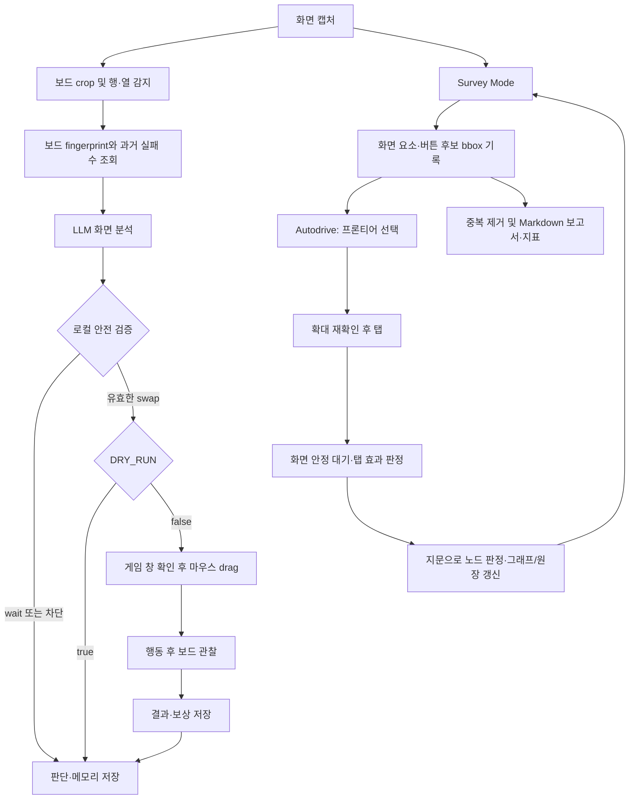

# Candy Crush Soda LLM Agent

Candy Crush Soda 화면을 캡처해 비전 LLM으로 분석하고, 로컬 안전 검증을 통과한 인접 셀 `swap`을 실행하는 데스크톱 실험용 에이전트입니다. 행동 뒤 보드 변화를 관찰해 실패한 수를 기억하며, 별도의 **Survey Mode**로 화면·버튼·보상·부스터 같은 게임 구조를 수집해 Markdown 보고서로 만들 수 있습니다.

**Autodrive**는 Survey 기록을 남기면서 안전한 버튼을 직접 눌러 화면 전환 그래프를 만듭니다. 누르기 직전 버튼 위치를 확대해 다시 확인하고, 탭 뒤 화면 변화를 픽셀로 판정하며, 같은 화면은 이미지 지문으로 알아봅니다. 세션을 반복 실행하면서 적중률과 누적 화면·전환 수를 지표로 남깁니다.

기본값은 `DRY_RUN=true`입니다. LLM 분석과 좌표 검증은 수행하지만 실제 마우스 입력은 하지 않습니다.

## 현재 구현 상태

| 영역 | 상태 | 설명 |
| --- | --- | --- |
| 화면 캡처 | 구현 | MSS로 보드, 게임 창 또는 모니터 캡처 |
| 보드 크기 감지 | 구현 | 반복 경계로 행·열을 추정하고 실패하면 고정값 사용 |
| 행동 추천 | 구현 | OpenAI 비전 모델의 구조화 응답으로 `wait` 또는 `swap` 선택 |
| 로컬 안전 검증 | 구현 | UI 상태, 보드 안정성, 좌표 범위, 인접성, 최소 확신도 검사 |
| 실제 마우스 조작 | 선택적 구현 | `DRY_RUN=false`이고 게임 창을 확인한 경우에만 드래그·탭 |
| 결과 관찰·메모리 | 구현 | 화면 변화로 결과를 분류하고 실패한 수와 역방향 수를 제외 |
| 게임 구조 조사 | 구현 | 화면 요소와 안전·위험 버튼 후보를 기록하고 보고서 생성 |
| 자동 탐색(Autodrive) | 구현 | 프론티어(안 눌러본 화면·행동)를 따라 이동하며 전환 그래프와 시도 원장 갱신 |
| 화면 식별 | 구현 | 이미지 지문(dHash)을 1차 기준으로, 버튼 목록을 보조 기준으로 같은 화면 판정 |
| 클릭 정확도 보정 | 구현 | 픽셀 bbox 좌표, 누르기 직전 확대 재확인, 탭 효과(빗나감) 판정, 뒤로 키 탈출 |
| 탐색 지표 | 구현 | 세션별 탭 적중률과 누적 화면·전환 수를 `metrics.md`/`metrics.csv`로 저장 |
| 영상 분석 | 현재 미포함 | 과거 파이프라인은 제거되었으며 필요하면 별도 모듈로 복원 가능 |
| 규칙 기반 최적 솔버 | 미구현 | 가능한 수 전체의 점수·목표 달성도를 계산하지 않음 |

주요 알고리즘과 자료구조는 [ALGORITHMS.md](ALGORITHMS.md)에 정리되어 있습니다.

## 동작 흐름



플레이 모드의 행동 결과는 다음처럼 처리합니다.

| 결과 | 의미 | 보상 | 후속 처리 |
| --- | --- | ---: | --- |
| `accepted` | 최종 보드 변화가 기준 이상 | `+1` | 정상 진행 |
| `rejected` | 변화가 생겼다가 원래 보드로 복귀 | `-1` | 같은 수와 역방향 수 제외 |
| `no_change` | 의미 있는 변화가 없음 | `-1` | 같은 수와 역방향 수 제외 |
| `unclear` | 제한 시간 안에 결과가 안정되지 않음 | `0` | 판단 보류 |

포커스, 권한, 마우스 제어 오류 같은 실행 환경 문제는 게임 규칙 실패로 학습하지 않고 보상 `0`으로 저장합니다.

## 설치

Python 3.9 이상의 데스크톱 환경에서 가상환경을 만든 뒤 의존성을 설치합니다.

```bash
python3 -m venv .venv
source .venv/bin/activate
python -m pip install -r candy_soda_agent/requirements.txt
cp candy_soda_agent/.env.example candy_soda_agent/.env
```

Windows PowerShell에서는 가상환경 활성화 명령으로 `.\.venv\Scripts\Activate.ps1`을 사용합니다. `make`가 있다면 `make setup` 한 번으로 위 과정을 대신할 수 있습니다.

## 설정

`candy_soda_agent/.env`에 API와 실행 정책을 설정합니다. 이 파일은 Git에서 제외되므로 실제 API 키를 커밋하지 마세요.

```env
OPENAI_API_KEY=
OPENAI_MODEL=gpt-5-mini
OPENAI_SURVEY_MODEL=gpt-4o-mini
FULL_IMAGE_DETAIL=low
BOARD_IMAGE_DETAIL=high
LLM_MAX_OUTPUT_TOKENS=600
SURVEY_LLM_MAX_OUTPUT_TOKENS=900
AUTO_GRID=true
MONITOR_INDEX=1
CAPTURE_MODE=window
DRY_RUN=true
GAME_WINDOW_TITLE=
SURVEY_ALLOW_TAPS=false
SURVEY_MIN_BUTTON_CONFIDENCE=0.60
SURVEY_DEDUP_SCAN_LIMIT=500
# 클릭 정확도: 누르기 직전 확대 재확인(true/false)과 그때 쓰는 모델
TAP_REFINE=true
OPENAI_TAP_MODEL=gpt-4.1-mini
# 막혔을 때 누를 에뮬레이터 뒤로 키(빈 값이면 끔)
BACK_KEY=esc
```

주요 환경변수는 다음과 같습니다.

| 설정 | 설명 |
| --- | --- |
| `CAPTURE_MODE` | `board`, `window`, `monitor` 중 LLM에 보낼 화면 범위 |
| `DRY_RUN` | `true`면 실제 마우스 입력 차단 |
| `GAME_WINDOW_TITLE` | 실제 입력 전에 확인할 앱(에뮬레이터) 창 이름. 실동작 시 필수 |
| `AUTO_GRID` | 이미지 기반 행·열 자동 감지 사용 여부 |
| `FULL_IMAGE_DETAIL`, `BOARD_IMAGE_DETAIL` | 전체 UI와 보드 이미지의 API detail 수준 |
| `SURVEY_ALLOW_TAPS` | 조사 모드에서 안전 후보 버튼 탭 허용 여부 |
| `OPENAI_MODEL` / `OPENAI_SURVEY_MODEL` / `OPENAI_TAP_MODEL` | 플레이 모드(다음 수 추론, reasoning 모델 필요), 조사 모드(구조 문서화만), 탭 직전 위치 재확인(위치 인식이 나은 모델)에 각각 쓰는 모델. 기본값은 `gpt-5-mini` / `gpt-4o-mini` / `gpt-4.1-mini` |
| `TAP_REFINE` | 누르기 직전 확대 재확인 사용 여부. `false`면 조사 모델 좌표를 그대로 누름 |
| `BACK_KEY` | 막혔을 때 누를 에뮬레이터 뒤로 키. 빈 값이면 끔 |

Autodrive의 세부 동작은 아래 값으로 조정합니다. 모두 선택 항목이며 기본값으로 충분합니다.

| 설정 | 기본값 | 설명 |
| --- | ---: | --- |
| `SCREEN_FINGERPRINT_MAX_DISTANCE` | `0.05` | 같은 화면 타입에서 이미지 지문 거리가 이 값 이하면 같은 화면. `0`이면 지문 매칭 끔 |
| `SCREEN_MATCH_MAX_BUTTON_DIFF` | `1` | 지문으로 못 찾았을 때, 버튼 목록이 이 개수 이하로만 다르면 같은 화면 |
| `SAME_SCREEN_PIXEL_THRESHOLD` | `0.01` | 두 캡처의 픽셀 차이가 이보다 작으면 "화면 그대로"(탭 빗나감·같은 노드 판정) |
| `TAP_REFINE_CROP_FRACTION` | `0.40` | 확대 재확인에서 잘라낼 정사각형 한 변(화면 긴 변 대비 비율) |
| `TAP_REFINE_MIN_CONFIDENCE` | `0.5` | 확대본에서 확신이 이보다 낮으면 전체 화면으로 한 번 더 찾음 |
| `TAP_REFINE_FULL_FALLBACK` | `true` | 위 전체 화면 재탐색 사용 여부 |
| `POST_TAP_MIN_WAIT`, `POST_TAP_INTERVAL`, `POST_TAP_TIMEOUT` | `0.6`, `0.25`, `5.0` | 탭 뒤 화면이 멈출 때까지 기다리는 최소 대기·캡처 간격·최대 대기(초) |
| `POST_TAP_STABLE_FRAMES`, `POST_TAP_STABLE_THRESHOLD` | `2`, `0.01` | 연속 몇 프레임이 이 차이보다 작으면 "멈췄다"고 볼지 |
| `TAP_MISS_RETRIES` | `1` | 빗나감(`missed`) 뒤 다시 누르는 횟수 |
| `STUCK_BACK_KEY_MAX` | `3` | 막혔을 때 뒤로 키를 누르는 최대 횟수 |
| `AUTODRIVE_STEP_PAUSE` | `0.5` | 스텝 사이 고정 대기(초) |
| `HOME_RESET_MAX_BACK_TAPS` | `6` | 루트로 돌아갈 때 home 버튼이 안 보이면 back을 누르는 최대 횟수 |
| `FRONTIER_MAX_REPLAN_ATTEMPTS`, `FRONTIER_MAX_MISSES` | `2`, `2` | 경로 재생 실패 시 루트 리셋 후 다시 시도하는 횟수 / 미시도 버튼이 연속으로 안 보이면 정리(`not_visible`)하는 관찰 횟수 |
| `RUN_ID`, `GAME_SLUG` | 자동, `candy_crush_soda` | 이어서 쓸 run 폴더 강제 지정, 출력 경로의 게임 식별자 |

화면 좌표와 감지 임계값은 `candy_soda_agent/config.py`에서 관리합니다.

- `MONITOR_INDEX`: 게임이 표시되는 모니터 번호
- `BOARD_OFFSET`: 선택한 모니터 기준 보드 영역
- `WINDOW_OFFSET`: `CAPTURE_MODE=window`에서 사용할 게임 창 영역
- `ROWS`, `COLS`: 자동 그리드 감지 실패 시 사용할 행·열 수
- `STABLE_THRESHOLD`, `NEW_BOARD_THRESHOLD`: 안정 화면과 새 보드 판단 기준
- `MAX_API_CALLS`, `API_COOLDOWN`: 자동 모드의 호출 상한과 최소 간격

레이아웃이나 해상도가 바뀌면 `BOARD_OFFSET`과 `WINDOW_OFFSET`을 다시 맞춰야 합니다. 자동 그리드는 행·열 수만 찾으며 보드의 화면 위치는 자동으로 찾지 않습니다.

## 실행

저장소 루트에서 `make`만 실행하면 모든 실행 명령을 확인할 수 있습니다. `Makefile`을 실행 명령의 단일 진입점으로 사용합니다.

```bash
# 처음 한 번만 실행: 가상환경·의존성 설치, .env 예시 파일 복사
make setup

# 가능한 명령과 설명 확인
make

# 캡처/보정
make preview
make calibrate

# 플레이
make once
make auto

# 구조 조사 및 보고서
make survey-once
make autodrive
make autodrive STEPS=20
make autodrive-repeat REPEAT=5
make autodrive-new REPEAT=5 STEPS=40
make survey-report

# 지표와 클릭 위치 진단
make metrics
make debug-points

# 단축키 모드와 테스트
make hotkeys
make test
```

파이썬 경로 기본값은 Windows에서 `.venv/Scripts/python.exe`, 그 외 환경에서 `.venv/bin/python`입니다. 다른 가상환경을 쓴다면 `make once PYTHON=python3`처럼 `PYTHON`을 넘길 수 있습니다. `make survey-auto`는 기존 `--survey-auto --survey-taps` 조합을 유지한 호환 명령입니다.

`make` 없이 직접 실행할 때 쓰는 주요 CLI 옵션은 다음과 같습니다. 전체 목록은 `python candy_soda_agent/main.py --help`로 확인합니다.

| 옵션 | 설명 |
| --- | --- |
| `--once`, `--auto` | 플레이 모드 한 번 분석 / 안정된 새 보드를 계속 분석 |
| `--survey-once` | 현재 화면의 게임 구조를 한 번 기록 |
| `--autodrive` (`--survey-auto`) | 자동 구조 조사. 실제 탭은 `--survey-taps` 필요 |
| `--autodrive-steps N` | 세션 하나의 최대 단계 수(기본 40) |
| `--autodrive-repeat N` | 세션을 N번 이어서 실행(같은 run에 누적, 세션마다 지표 갱신) |
| `--autodrive-pause 초` | 반복 실행에서 세션 사이 대기(기본 3초) |
| `--new-run` | 새 run 폴더로 시작. `current_run.txt`도 바뀌어 다음 실행부터 이 run을 이어감 |
| `--survey-report` | 저장된 조사 로그로 보고서 재생성 |
| `--survey-metrics` | 현재 run의 세션별 지표(`metrics.md`/`metrics.csv`)를 계산하고 종료 |
| `--hotkeys` | F8/F9/ESC 단축키 모드 |

`--hotkeys`를 함께 사용하면 F8은 한 번 분석, F9는 자동 분석 시작·중지, ESC는 종료입니다. macOS에서는 단축키 라이브러리 문제를 피하기 위해 `--once` 또는 `--auto`를 권장합니다. `--autodrive`/`--survey-auto`와도 함께 쓸 수 있으며, 이때는 ESC만 의미가 있고(F8/F9는 대상 없음) 누르면 진행 중이던 탭까지 취소하고 지금까지 기록으로 보고서를 남긴 뒤 멈춥니다. 프로그램이 `BACK_KEY`로 ESC를 직접 보내는 동안에는 그 입력을 종료 요청으로 보지 않습니다.

실제 동작 전에는 반드시 `DRY_RUN=true`로 캡처 영역, 격자 번호, 추천 좌표를 확인하세요. `DRY_RUN=false`에서는 `GAME_WINDOW_TITLE`이 필요하며, macOS에서는 실행 앱에 **화면 기록**과 **손쉬운 사용** 권한을 부여해야 합니다.

`--survey-once`는 현재 화면만 기록합니다. `--autodrive`는 화면마다 같은 Survey 기록을 남기면서 실제 전환 그래프를 갱신합니다. `--survey-auto`는 호환 별칭이며, 실제 탭에는 `DRY_RUN=false`와 `SURVEY_ALLOW_TAPS=true` 또는 `--survey-taps`가 필요합니다. 구매, 광고 시청, 로그인, 계정 연결, 권한 요청 후보는 기록만 하고 누르지 않습니다.

### 클릭 정확도와 반복 실험

Autodrive는 탭 한 번을 이렇게 처리합니다.

1. 조사 모델(`OPENAI_SURVEY_MODEL`)이 버튼마다 픽셀 bbox를 적고, 그 중심을 탭 좌표로 씁니다.
2. 누르기 직전 그 주변을 잘라 확대하고 열 글자/행 숫자 격자를 그려 `OPENAI_TAP_MODEL`(기본 `gpt-4.1-mini`)에게 위치를 다시 묻습니다(`TAP_REFINE=true`). 못 찾으면 전체 화면으로 한 번 더 찾고, 그래도 없으면 누르지 않습니다(`not_found`). API 호출 자체가 실패하면 탐색을 멈추지 않고 처음 좌표로 누릅니다.
3. 탭 뒤 화면이 멈출 때까지 기다리고(`POST_TAP_*`), 픽셀이 그대로면 빗나감(`missed`)으로 보고 `TAP_MISS_RETRIES`번 다시 누른 뒤 `no_change`로 닫습니다. 빗나간 탭으로는 간선을 만들지 않습니다.
4. 다음 캡처가 직전과 픽셀로 같으면(`SAME_SCREEN_PIXEL_THRESHOLD`) LLM이 화면 타입을 다르게 불러도 같은 노드로 셉니다.
5. 가는 길을 모르는 화면에 갇히면 에뮬레이터 뒤로 키(`BACK_KEY`, 기본 `esc`)를 `STUCK_BACK_KEY_MAX`번까지 누릅니다. 루트에서는 누르지 않습니다. 이어서 하는 run이 루트가 아닌 화면에서 시작하면 먼저 루트로 돌아갑니다.

`BACK_KEY`는 에뮬레이터마다 다릅니다. 게임 화면(LDPlayer 등)에서 그 키를 직접 눌러 Android 뒤로처럼 동작하는지 먼저 확인하고, 아니면 맞는 키로 바꾸거나 빈 값으로 끄세요.

```bash
make autodrive-new REPEAT=5 STEPS=40   # 새 run 폴더에서 40스텝 세션 5번
make autodrive-repeat REPEAT=5         # 현재 run에 이어서 5번
make metrics                           # 세션별 적중률·누적 화면/전환 (run 폴더의 metrics.md, metrics.csv)
make debug-points                      # 클릭 위치·bbox·보정 화살표를 캡처 위에 그려 확인
```

반복 실행은 프론티어가 소진(`converged`)되거나 취소·오류·클릭 차단이면 남은 세션을 건너뛰고, 가는 길을 몰라 끝난 세션(`unreachable`)은 다음 세션이 루트 정렬부터 다시 시작합니다. 세션마다 `metrics.md`를 갱신하며, 누적 화면·누적 전환이 세션을 거듭해도 거의 늘지 않으면 그래프가 수렴한 것입니다.

`survey_metrics.py`와 `debug_survey_points.py`는 `config.py`를 불러오지 않아 새 run 포인터를 만들지 않으므로 아무 때나 돌려도 됩니다. 특정 run을 보려면 `--run run_YYYY-MM-DD_HH-MM-SS`를 넘깁니다. 기준선 진단(run_2026-09-21_10-51-14)에서는 탭 24번 중 13번이 화면을 바꾸지 못해 적중률이 46%였습니다.

### 화면 식별과 시도 원장

LLM이 보고하는 버튼 목록은 같은 화면을 봐도 관찰마다 달라 화면 노드가 쪼개지는 주원인이었습니다. 그래서 새 관찰은 다음 순서로 기존 노드에 붙입니다.

1. 같은 화면 타입 노드 중 이미지 지문(dHash) 거리가 `SCREEN_FINGERPRINT_MAX_DISTANCE` 이하인 노드
2. 화면 타입 + 정규화 버튼 목록이 정확히 같은 노드(지문이 크게 다르면 거부)
3. 버튼 1개 차이까지 허용한 매칭(여기도 지문 충돌은 거부)

어디에도 맞지 않으면 새 노드를 만듭니다. 예전처럼 상점·설정 같은 화면 타입을 이름만으로 한 노드에 묶지 않습니다. 화면 타입에는 `profile`, `social_friends`, `help_support`가 추가되었습니다.

`(화면, 행동)` 시도 결과는 `ledger.json`에 기록되며, 판정 값은 `new_screen`, `known_screen`, `no_change`, `blocked`, `failed`, `not_visible`, `missed`(빗나감, 재시도 대기), `not_found`(확대 재확인에서 못 찾아 정리)입니다. 보고서의 프론티어 섹션도 이 값을 따라 나뉩니다.

## 저장 결과

출력 경로는 명령을 실행한 현재 디렉터리를 기준으로 정해집니다. 저장소 루트에서 실행하는 것을 권장합니다. 조사·탐색 기록은 run 단위 폴더에 모이고, 플레이 모드 기록은 `output/` 바로 아래에 남습니다.

```text
output/
├── preview_raw.png                 보드 캡처 미리보기
├── preview_grid.png                격자 오버레이 미리보기
├── captures/                       분석 전후 및 조사 증거 이미지
├── runs.jsonl                      플레이 모드 LLM 판단, 그리드, 검증 결과
└── candy_crush_soda/               GAME_SLUG
    ├── current_run.txt             이어서 쓸 run_id
    └── runs/<run_id>/
        ├── game_survey.jsonl       게임 구조 조사 기록
        ├── game_survey_report.md   조사 기록과 실제 전환 통합 보고서
        ├── metrics.md, metrics.csv 세션별 적중률·누적 화면/전환
        ├── debug_points/           클릭 위치 진단 이미지와 summary.md
        └── navigation/
            ├── graph.json          Autodrive 화면 전환 그래프
            ├── ledger.json         (화면, 행동) 시도 원장
            ├── journeys.jsonl      탐색 단계 기록
            └── representatives/    화면별 대표 이미지
memory.jsonl                        행동 결과, 보상, fingerprint, 교훈
```

JSONL 파일은 실행할 때마다 기존 내용을 덮어쓰지 않고 한 줄씩 추가됩니다. 새 탐색을 따로 시작하려면 `--new-run`(또는 `make autodrive-new`)을 쓰거나 `RUN_ID`를 지정합니다.

## 프로젝트 구조

```text
SugarCrushSoda_GA/
├── README.md
├── ALGORITHMS.md               주요 알고리즘·자료구조 정리
├── Makefile                    실행 명령 단일 진입점
├── memo.txt                    CLI 명령 모음
└── candy_soda_agent/
    ├── main.py                 실행 진입점, Autodrive 반복 세션·지표 출력
    ├── cli.py                  CLI 옵션과 실행 모드 조합 검증
    ├── config.py               좌표, 임계값, 모델, run 폴더, 저장 경로 설정
    ├── schemas.py              플레이·조사·탭 재확인 구조화 응답 모델
    ├── llm_request.py          비전 LLM 구조화 요청 공통 함수
    ├── run_loop.py             F8 단발·F9 자동 분석 실행 루프
    ├── play_session.py         플레이 한 프레임 분석과 행동 결과 기록
    ├── hotkeys.py              F8/F9/ESC 단축키(프로그램이 보낸 ESC는 무시)
    ├── capture.py              MSS 캡처와 프레임 차이 계산
    ├── capture_modes.py        board/window/monitor 캡처 구성
    ├── grid_detector.py        이미지 기반 행·열 감지
    ├── image_utils.py          격자 오버레이, 인코딩, fingerprint(dHash)
    ├── agent.py                플레이 모드 LLM 요청과 응답 검증
    ├── coordinate_mapper.py    셀을 화면 좌표로 변환
    ├── action_executor.py      앱 포커스 확인, 마우스 입력, 뒤로 키 입력
    ├── safety_guard.py         취소 검사(연결됨: play_session/autodrive 실행 직전)
    ├── reward.py               행동 결과 분류와 보상 계산
    ├── storage.py              이미지·JSONL·메모리 저장과 조회
    ├── survey.py               조사 분석·기록 공통 계층, bbox → 탭 좌표 변환
    ├── survey_utils.py         조사 중복 키와 버튼 우선순위
    ├── survey_report.py        조사·전환 통합 보고서 생성
    ├── survey_metrics.py       세션별 탐색 지표(metrics.md/csv)
    ├── tap_refine.py           누르기 직전 확대 재확인
    ├── tap_effect.py           탭 뒤 화면 안정 대기와 빗나감 판정
    ├── debug_survey_points.py  클릭 위치 진단 이미지 생성
    ├── navigation/
    │   ├── navigator.py        Autodrive 메인 루프
    │   ├── frontier.py         프론티어 이동·루트 리셋(FrontierWalker)
    │   ├── graph.py            전환 그래프와 화면 식별(지문·버튼 매칭)
    │   ├── ledger.py           (화면, 행동) 시도 원장
    │   ├── observer.py         화면 ID와 버튼 정규화
    │   └── policy.py           화면별 미탐색 안전 버튼 선택
    ├── preview_capture.py      캡처·격자 미리보기
    ├── calibrate_region.py     보드 영역 보정 도구
    ├── .env.example            환경변수 예시
    ├── requirements.txt
    └── tests/                  핵심 로직 단위 테스트
```

## 테스트

네트워크나 실제 마우스 입력 없이 핵심 로직을 검증합니다.

```bash
make test
# 또는
python -m unittest discover -s candy_soda_agent/tests -v
```

현재 161개 테스트가 자동 그리드, 좌표 변환, 앱 포커스, 행동 검증·관찰, 실패 수 메모리, Survey 저장, Autodrive 연계·취소 연결, 보고서 생성에 더해 이미지 지문 기반 화면 식별, bbox 중심 계산, 확대 재확인 좌표 복원, 탭 효과(빗나감) 판정, 뒤로 키 탈출과 반복 실행 지원을 검사합니다. 실제 OpenAI API 호출과 에뮬레이터 마우스 입력은 사용자 환경에서 별도로 확인해야 합니다.

## 현재 한계와 권장 로드맵

| 우선순위 | 제안 | 이유 |
| --- | --- | --- |
| P0 | (완료) `safety_guard.cancellation_reason`을 `execute_decision`/`execute_button_tap` 실행 직전에 연결 | ESC 또는 F9 중지 시 실행 중이던 클릭까지 취소. play 모드는 항상 켜져 있고, autodrive는 `--hotkeys`를 함께 줘야 ESC가 동작 |
| P0 | (완료) 클릭 정확도 개선: bbox 좌표, 확대 재확인, 탭 효과 판정, 뒤로 키 탈출, 세션 지표 | 기준선에서 조사 모델 좌표의 58%가 x=0.5였고 탭 적중률이 46%였음 |
| P0 | `--new-run`으로 40스텝 x 5세션 실험 후 `metrics.md` 비교 | 적중률이 기준선(46%)보다 오르는지, 누적 화면·전환이 평평해지는지 확인 필요 |
| P0 | 에뮬레이터에서 `BACK_KEY`(기본 ESC)가 Android 뒤로로 동작하는지 확인 | 막힘 탈출과 루트 리셋이 이 키에 의존함 |
| P0 | `safety_guard.validate_fresh_board`(최신 보드 재검증)는 아직 미연결 | LLM 응답을 기다리는 동안 보드가 바뀐 경우를 잡으려면 실행 직전 재캡처와 임계값 설정이 추가로 필요함(취소 검사와는 별도 작업) |
| P0 | 점수, 남은 수, 목표 달성, 레벨 완료를 결과 판정에 추가 | 현재는 픽셀 변화량이 주 신호라 애니메이션을 성공으로 오인할 수 있음 |
| P1 | 실행별 세션 요약과 사람이 읽기 쉬운 로그 포맷 제공 | Autodrive는 `metrics.md`로 세션 요약이 생겼지만 플레이 모드는 저장 헬퍼가 메인 루프와 연결되지 않아 문제 원인과 비용을 한눈에 보기 어려움 |
| P1 | 제거된 영상 분석을 독립적인 오프라인 도구로 재도입 | 과거 플레이를 학습·회귀 데이터셋으로 활용할 수 있음. 기존 구현은 Git 커밋 `71ef5fd`의 부모에서 복구 가능 |
| P1 | `.env`, `config.py`, CLI 설정을 하나의 검증된 설정 계층으로 통합 | 현재 일부 좌표는 코드 수정이 필요하고 예시 환경변수와 실제 읽는 값 사이에 차이가 있음 |
| P2 | 규칙 기반 후보 생성 후 LLM이 후보를 평가하도록 분리 | 좌표 환각을 줄이고 여러 수를 비교해 전략 품질과 테스트 가능성을 높일 수 있음 |

영상 기능은 기존 코드를 그대로 되돌리기보다, 현재 `memory.jsonl` 스키마와 보상 체계에 맞춘 별도 `offline_video/` 모듈로 복원하는 편이 안전합니다. 영상 디코딩·최초 swap 감지는 로컬에서 처리하고, LLM은 목표·점수·결과처럼 시각적 의미 판정에만 사용하는 구성이 적합합니다.

이 프로젝트는 아직 실험 단계이며, 실제 점수 증가나 목표 달성을 직접 계산하는 게임 규칙 엔진은 포함하지 않습니다.
