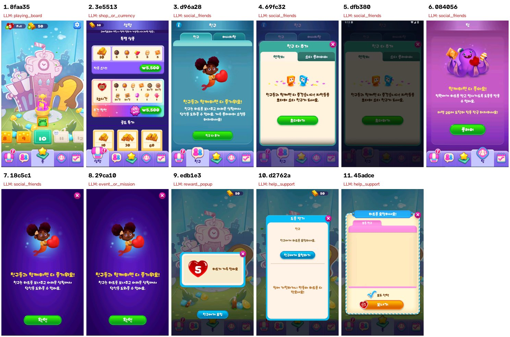

# 화면 타입 검수표 (큰 화면 타입안)

버튼이나 요소가 아니라 **화면 전체가 무엇을 하는 곳인지**만 나누는 안입니다. 예전 16개(+후보 3개)를 10개로 줄였습니다. **2026-10-11 검수 후 `screen_types.json`에 적용했습니다**(고르는 원칙은 `rules`로 프롬프트에 들어감). 예전 타입으로 만든 run은 이어 쓰지 않고 새 run으로 시작합니다.

## 1. 큰 화면 타입 10개

| id | 한글 | 무엇인가 | 처리 |
|---|---|---|---|
| play | 플레이 화면 | 실제로 게임을 하는 화면. 매치3면 격자 보드 | 기록만 하고 나옴 |
| home | 홈·메인 | 게임의 중심 화면. 사가 지도, 로비 등 | 탐색 |
| level | 레벨 시작·결과 | 플레이 직전(목표·준비)과 직후(결과) 화면 | 탐색 |
| popup | 팝업·알림 | 다른 화면 위에 뜬 작은 창. 보상, 안내, 이벤트 알림, 확인창 | 탐색 |
| menu | 메뉴·하위 화면 | 화면 전체를 차지하는 하위 페이지. 설정, 프로필, 친구, 이벤트 목록 등 | 탐색 |
| shop | 상점·결제 | 돈이나 재화로 무언가를 사는 화면이나 팝업 | 탐색 |
| ad | 광고 | 재생 중인 광고, 광고 보기 제안 | 탐색 |
| tutorial | 튜토리얼 | 손가락·말풍선으로 조작을 알려 주는 화면 | 탐색 |
| loading | 로딩 | 로딩·연결 중 | 기다렸다 다시 봄 |
| unknown | 기타 | 위 어디에도 안 맞음 | 탐색 |

**고르는 원칙**
- 버튼·아이콘·요소는 보지 않는다. 그건 `button_candidates`와 `game_elements`가 따로 기록한다.
- 팝업이 떠 있으면 뒤 배경이 아니라 앞의 팝업 기준으로 고른다.
- 겹치면 이 순서로 고른다: play > level > ad > shop > tutorial > loading > popup / menu > home > unknown.
- popup과 menu는 크기로 가른다. 배경이 비치거나 어두워진 작은 창이면 popup, 화면을 꽉 채우면 menu.

## 2. 매치3 게임 형태별로 나오는 타입

| 형태 | 예시 흐름 | 특징 |
|---|---|---|
| 사가 지도형 | home(지도) → level(시작) → play → level(결과) → home | 하단 탭바가 흔하고, 팝업이 많다 |
| 로비형 | home(로비) → [level(시작)] → play → level(결과) → home | 홈에 큰 플레이 버튼과 메뉴 아이콘이 있다 |
| 보드 반복형 | play → [level(결과)] → play → … | home이 없거나 거의 없다. 메뉴는 보드 안 일시정지·톱니로만 연다 |

보드 반복형은 플레이 화면이 곧 메인 화면이라, 지금처럼 플레이를 피하면(PLAY_POLICY=avoid) 탐색할 게 거의 없습니다. 이런 게임은 나중에 handoff(플레이 코드 연결) 쪽에서 다뤄야 합니다.

## 3. 지금 타입 → 큰 타입 대응

| 지금 | 큰 타입 |
|---|---|
| playing_board | play |
| map_or_level_select | home |
| level_start, level_complete | level |
| reward_popup, booster_panel, (후보) notice_popup, quit_confirm, pause_menu | popup |
| settings_menu, profile, social_friends, help_support, event_or_mission | menu (작은 창으로 뜨면 popup) |
| shop_or_currency | shop |
| ad_or_offer | ad (돈으로 사는 특가는 shop) |
| tutorial, loading | 그대로 |
| unknown_but_recordable | unknown |

## 4. 지난 run 화면을 큰 타입으로 다시 분류

| # | 화면 | 모델이 붙인 타입(지금) | 큰 타입 |
|---|---|---|---|
| 1 | 사가 지도 | playing_board ❌ | home |
| 2 | 상점 탭 | shop_or_currency | shop |
| 3 | 친구 탭 | social_friends | menu |
| 4 | 친구 더 추가 창 | social_friends | popup |
| 5 | 4번이 어둡게 덮인 상태 | social_friends | popup |
| 6 | 팀 탭 | social_friends | menu |
| 7 | 친구 기능 안내 | social_friends | popup |
| 8 | 7번과 같은 화면 | event_or_mission | popup |
| 9 | 하트 가득 알림 | reward_popup | popup |
| 10 | 도움 받기 | help_support ❌ | popup |
| 11 | 하트 요청 보내기 | help_support ❌ | popup |

지금 분류로는 11개 중 4개가 틀렸고, 같은 화면인 7·8번이 서로 다른 타입이 되어 노드가 갈렸습니다. 큰 타입으로 나누면 7·8번이 같은 popup이 되고, 10·11번처럼 세부 타입을 헷갈릴 여지가 거의 없어집니다.

## 5. 적용해서 달라진 것

- **좋아지는 것:** 같은 화면이 타입 차이로 갈리는 일이 줄어듭니다. 같은 화면 판정이 같은 타입 안에서만 비교하기 때문이에요. 프롬프트도 짧아집니다.
- **잃는 것:** 화면 단위로는 소셜·이벤트·설정을 구분하지 않습니다. 등급 분류에 필요한 소셜·결제·광고 정보는 `game_elements`의 category와 버튼 role에 그대로 남습니다.
- **조심할 것:** popup이 넓어지면서 서로 다른 팝업이 같은 타입이 됩니다. 지난 run 표본에서 서로 다른 팝업끼리의 이미지 지문(dHash, 전체 화면 기준) 거리는 0.25 이상이라, 지금 임계값(0.05)으로는 합쳐지지 않습니다.
- **고친 곳:** `screen_types.json`(id 교체, `rules` 추가), 옛 id를 쓰던 코드(`survey_utils`의 상점·홈 규칙, `ui_knowledge.json`의 `home_screen_types`를 `home`으로, 기본 타입 이름 `unknown`), 옛 id를 쓰던 테스트.

## 6. 결정 기록

- [x] 10개로 확정(2026-10-11)
- [x] 겹칠 때 우선순위: 위 1번 그대로
- [x] 예전 run은 이어 쓰지 않고 새 run으로 시작(`make autodrive-new`). 예전 타입이 남은 run에서 autodrive를 돌리면 시작 전에 멈추고 안내합니다.
