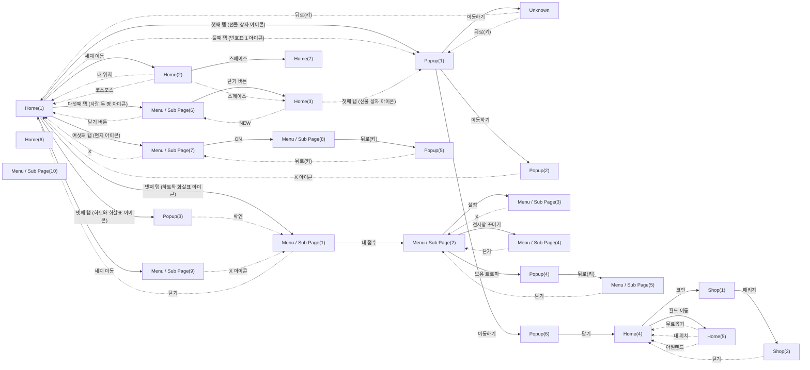

# Game Structure Survey

이 문서는 `game_survey.jsonl`의 화면 캡처와 구조화된 조사 기록으로 생성되었습니다.

## Overview

- Game: Anipang 2 (장르: 매치3 퍼즐)
- Survey records: 149
- Unique screen signatures: 30
- Navigation nodes: 26 (화면 타입별: home 7, menu 10, popup 6, shop 2, unknown 1)
- ⚠️ 화면 파편화 의심: Home 7개, Menu / Sub Page 10개, Popup 6개 (기준 3개 이상). 실제로 서로 다른 화면이면 무시해도 되고, 같은 화면이 쪼개진 것이면 아래 Screen Hierarchy에서 대표 이미지를 비교해 확인하세요.
- ⚠️ 합쳐짐 의심: **Popup(1)**의 '이동하기' → Unknown, Popup(2), Popup(6). 같은 버튼이 여러 화면으로 갔습니다. 서로 다른 화면이 한 노드로 합쳐졌을 수 있으니 이 화면에 붙은 캡처들을 비교하세요(닫기류는 연 화면으로 돌아가는 정상일 수도 있음). 합쳐진 것이면 `SCREEN_HOG_MAX_DISTANCE`를 내립니다.
- ⚠️ 합쳐짐 의심: **Home(1)**의 '넷째 탭 (하트와 화살표 아이콘)' → Popup(3), Menu / Sub Page(1). 같은 버튼이 여러 화면으로 갔습니다. 서로 다른 화면이 한 노드로 합쳐졌을 수 있으니 이 화면에 붙은 캡처들을 비교하세요(닫기류는 연 화면으로 돌아가는 정상일 수도 있음). 합쳐진 것이면 `SCREEN_HOG_MAX_DISTANCE`를 내립니다.
- ⚠️ 합쳐짐 의심: **Menu / Sub Page(6)**의 '닫기 버튼' → Home(1), Home(3). 같은 버튼이 여러 화면으로 갔습니다. 서로 다른 화면이 한 노드로 합쳐졌을 수 있으니 이 화면에 붙은 캡처들을 비교하세요(닫기류는 연 화면으로 돌아가는 정상일 수도 있음). 합쳐진 것이면 `SCREEN_HOG_MAX_DISTANCE`를 내립니다.
- ⚠️ 합쳐짐 의심: **Home(1)**의 '세계 이동' → Home(2), Menu / Sub Page(9). 같은 버튼이 여러 화면으로 갔습니다. 서로 다른 화면이 한 노드로 합쳐졌을 수 있으니 이 화면에 붙은 캡처들을 비교하세요(닫기류는 연 화면으로 돌아가는 정상일 수도 있음). 합쳐진 것이면 `SCREEN_HOG_MAX_DISTANCE`를 내립니다.
- ⚠️ 합쳐짐 의심: **Home(2)**의 '스페이스' → Home(3), Home(7). 같은 버튼이 여러 화면으로 갔습니다. 서로 다른 화면이 한 노드로 합쳐졌을 수 있으니 이 화면에 붙은 캡처들을 비교하세요(닫기류는 연 화면으로 돌아가는 정상일 수도 있음). 합쳐진 것이면 `SCREEN_HOG_MAX_DISTANCE`를 내립니다.

## Game Structure Diagram

Autodrive가 관찰한 실제 화면 전환입니다. 실선은 루트에서 BFS로 만든 계층(트리), 점선은 트리에 들어가지 않은 교차 링크입니다.

연결선은 실제 전환, `survey only`는 조사 기록에만 있는 화면입니다.
눌러도 같은 화면으로 돌아온 간선 13개는 그리지 않았습니다(아래 Cross Links 참고).

## Screen Hierarchy

루트에서 BFS로 투영한 화면 계층입니다.

- **Home(1)** (`home`, visits=23)
  - Evidence: navigation/representatives/screen_aaa4dfd7e636.png
  - **Popup(1)** (`popup`, visits=8) — via '첫째 탭 (선물 상자 아이콘)'
    - Evidence: navigation/representatives/screen_b181d370d396.png
    - **Unknown** (`unknown`, visits=5) — via '이동하기'
      - Evidence: navigation/representatives/screen_50d8b4a941c2.png
    - **Popup(2)** (`popup`, visits=1) — via '이동하기'
      - Evidence: navigation/representatives/screen_068de1e71d3a.png
    - **Popup(6)** (`popup`, visits=1) — via '이동하기'
      - Evidence: navigation/representatives/screen_29344fc062d0_d0e462.png
      - **Home(4)** (`home`, visits=25) — via '닫기'
        - Evidence: navigation/representatives/screen_783631a9bd26.png
        - **Shop(1)** (`shop`, visits=1) — via '코인'
          - Evidence: navigation/representatives/screen_0da5aaec9dbd.png
          - **Shop(2)** (`shop`, visits=4) — via '패키지'
            - Evidence: navigation/representatives/screen_c6e5701c376d.png
        - **Home(5)** (`home`, visits=6) — via '월드 이동'
          - Evidence: navigation/representatives/screen_7eb3a576032c.png
  - **Popup(3)** (`popup`, visits=2) — via '넷째 탭 (하트와 화살표 아이콘)'
    - Evidence: navigation/representatives/screen_29344fc062d0.png
  - **Menu / Sub Page(6)** (`menu`, visits=7) — via '다섯째 탭 (사람 두 명 아이콘)'
    - Evidence: navigation/representatives/screen_61c29569dfcf.png
    - **Home(3)** (`home`, visits=3) — via '닫기 버튼'
      - Evidence: navigation/representatives/screen_11eb9eddd33f.png
  - **Menu / Sub Page(7)** (`menu`, visits=6) — via '여섯째 탭 (편지 아이콘)'
    - Evidence: navigation/representatives/screen_6428c564c297.png
    - **Menu / Sub Page(8)** (`menu`, visits=5) — via 'ON'
      - Evidence: navigation/representatives/screen_0499361cf645.png
      - **Popup(5)** (`popup`, visits=7) — via '뒤로(키)'
        - Evidence: navigation/representatives/screen_c51f067d123c.png
  - **Home(2)** (`home`, visits=6) — via '세계 이동'
    - Evidence: navigation/representatives/screen_9c8f5a01da8d.png
    - **Home(7)** (`home`, visits=1) — via '스페이스'
      - Evidence: navigation/representatives/screen_cd5be623caf7.png
  - **Menu / Sub Page(9)** (`menu`, visits=2) — via '세계 이동'
    - Evidence: navigation/representatives/screen_61190cc79c32.png
  - **Menu / Sub Page(1)** (`menu`, visits=8) — via '넷째 탭 (하트와 화살표 아이콘)'
    - Evidence: navigation/representatives/screen_3fd34a8353d0.png
    - **Menu / Sub Page(2)** (`menu`, visits=8) — via '내 점수'
      - Evidence: navigation/representatives/screen_326c21f5064c.png
      - **Menu / Sub Page(3)** (`menu`, visits=3) — via '설정'
        - Evidence: navigation/representatives/screen_74d409d29297.png
      - **Menu / Sub Page(4)** (`menu`, visits=4) — via '전시장 꾸미기'
        - Evidence: navigation/representatives/screen_8ea31e1e4f17.png
      - **Popup(4)** (`popup`, visits=6) — via '보유 트로피'
        - Evidence: navigation/representatives/screen_036fa1ae013b.png
        - **Menu / Sub Page(5)** (`menu`, visits=5) — via '뒤로(키)'
          - Evidence: navigation/representatives/screen_de0d1440e615.png

### 트리에 없는 화면 (루트에서 가는 길을 모름)

관찰은 했지만 루트에서 오는 전환이 기록되지 않아 계층에 넣지 못했습니다. 탐색이 중간에 끊겼거나 화면이 쪼개졌다는 신호입니다.

- **Home(6)** (`home`, visits=1)
  - Evidence: navigation/representatives/screen_3bb23609ee12.png
- **Menu / Sub Page(10)** (`menu`, visits=1)
  - Evidence: navigation/representatives/screen_89fd4deb723b.png

### Cross Links (트리 밖 간선)

- **Menu / Sub Page(1)** (`menu`, visits=8): 눌러도 화면이 그대로인 버튼 1개 — 튜토리얼
- **Home(4)** (`home`, visits=25): 눌러도 화면이 그대로인 버튼 7개 — 첫째 탭 (선물 상자 아이콘), 둘째 탭 (번호표 1 아이콘), 무료, 일곱째 탭 (톱니바퀴 아이콘), 100, 넷째 탭 (하트와 화살표 아이콘), 월드 이동
- **Home(1)** (`home`, visits=23): 눌러도 화면이 그대로인 버튼 3개 — 셋째 탭 (토끼 손가락 아이콘), 레벨 1 버튼, 넷째 탭 (하트와 화살표 아이콘)
- **Popup(1)** (`popup`, visits=8): 눌러도 화면이 그대로인 버튼 1개 — 이동하기
- **Shop(2)** (`shop`, visits=4): 눌러도 화면이 그대로인 버튼 1개 — 더 보기
- **Home(1)** (`home`, visits=23) --(둘째 탭 (번호표 1 아이콘))--> **Popup(1)** (`popup`, visits=8)
- **Popup(3)** (`popup`, visits=2) --(확인)--> **Menu / Sub Page(1)** (`menu`, visits=8)
- **Menu / Sub Page(6)** (`menu`, visits=7) --(닫기 버튼)--> **Home(1)** (`home`, visits=23)
- **Menu / Sub Page(7)** (`menu`, visits=6) --(X)--> **Home(1)** (`home`, visits=23)
- **Home(2)** (`home`, visits=6) --(내 위치)--> **Home(1)** (`home`, visits=23)
- **Home(2)** (`home`, visits=6) --(코스모스)--> **Home(1)** (`home`, visits=23)
- **Home(2)** (`home`, visits=6) --(스페이스)--> **Home(3)** (`home`, visits=3)
- **Menu / Sub Page(9)** (`menu`, visits=2) --(X 아이콘)--> **Menu / Sub Page(1)** (`menu`, visits=8)
- **Menu / Sub Page(1)** (`menu`, visits=8) --(닫기)--> **Home(1)** (`home`, visits=23)
- **Unknown** (`unknown`, visits=5) --(뒤로(키))--> **Home(1)** (`home`, visits=23)
- **Unknown** (`unknown`, visits=5) --(뒤로(키))--> **Popup(1)** (`popup`, visits=8)
- **Popup(2)** (`popup`, visits=1) --(X 아이콘)--> **Home(1)** (`home`, visits=23)
- **Home(3)** (`home`, visits=3) --(NEW)--> **Menu / Sub Page(6)** (`menu`, visits=7)
- **Home(3)** (`home`, visits=3) --(첫째 탭 (선물 상자 아이콘))--> **Popup(1)** (`popup`, visits=8)
- **Popup(5)** (`popup`, visits=7) --(뒤로(키))--> **Menu / Sub Page(7)** (`menu`, visits=6)
- **Menu / Sub Page(3)** (`menu`, visits=3) --(X)--> **Menu / Sub Page(2)** (`menu`, visits=8)
- **Menu / Sub Page(4)** (`menu`, visits=4) --(닫기)--> **Menu / Sub Page(2)** (`menu`, visits=8)
- **Home(5)** (`home`, visits=6) --(무료뽑기)--> **Home(4)** (`home`, visits=25)
- **Home(5)** (`home`, visits=6) --(내 위치)--> **Home(4)** (`home`, visits=25)
- **Home(5)** (`home`, visits=6) --(아일랜드)--> **Home(4)** (`home`, visits=25)
- **Menu / Sub Page(5)** (`menu`, visits=5) --(닫기)--> **Menu / Sub Page(2)** (`menu`, visits=8)
- **Shop(2)** (`shop`, visits=4) --(닫기)--> **Home(4)** (`home`, visits=25)

## Persistent UI

여러 화면에 같은 모습·같은 자리로 보이는 UI입니다. 공통 버튼은 화면마다가 아니라 한 번만 눌러 보고, 그 결과는 버튼이 보이는 모든 화면에서 지름길로 씁니다.

- 공통 띠: 위 125px, 아래 0px (화면 3개가 공유, 화면 높이 1348px). 같은 화면 판정에서는 이 영역을 빼고 비교합니다.
- 공통 버튼 **첫째 탭 (선물 상자 아이콘)**: 4개 화면에서 보임, → Popup(1)
- 공통 버튼 **둘째 탭 (번호표 1 아이콘)**: 4개 화면에서 보임, → Popup(1)
- 공통 버튼 **셋째 탭 (토끼 손가락 아이콘)**: 2개 화면에서 보임, no_change
- 공통 버튼 **넷째 탭 (하트와 화살표 아이콘)**: 4개 화면에서 보임, → Menu / Sub Page(1)
- 공통 버튼 **다섯째 탭 (사람 두 명 아이콘)**: 4개 화면에서 보임, → Menu / Sub Page(6)
- 공통 버튼 **여섯째 탭 (편지 아이콘)**: 2개 화면에서 보임, → Menu / Sub Page(7)
- 공통 버튼 **일곱째 탭 (톱니바퀴 아이콘)**: 4개 화면에서 보임, → Home(4)
- 공통 버튼 **설정**: 2개 화면에서 보임, → Menu / Sub Page(3)
- 공통 버튼 **+ 하트**: 4개 화면에서 보임, no_change
- 공통 버튼 **내 위치**: 2개 화면에서 보임, → Home(1)
- 공통 버튼 **코스모스**: 2개 화면에서 보임, → Home(1)
- 공통 버튼 **스페이스**: 2개 화면에서 보임, → Home(7)
- 공통 버튼 **아일랜드**: 2개 화면에서 보임, → Home(4)
- 공통 버튼 **NEW**: 2개 화면에서 보임, → Menu / Sub Page(6)
- 공통 버튼 **무료**: 2개 화면에서 보임, → Home(4)
- 공통 버튼 **코인 아이콘**: 3개 화면에서 보임, → Shop(1)
- 공통 버튼 **1**: 2개 화면에서 보임, not_found

## Exploration Frontier

- 탐색 커버리지: 54/79 ((화면,행동) 조합 기준, 눌러본 것/발견한 것, 누르지 않고 정리된 것 23개)

### 아직 안 눌러본 프론티어

- **Popup(2)**: 게임으로
- **Home(6)**: SCROLL DOWN

### 도달 실패로 포기함(blocked)

- **Shop(1)**: 루비
- **Home(3)**: 여덟째 탭 (회색 톱니바퀴 아이콘)
- **Menu / Sub Page(9)**: 일반 기록

### 다시 봐도 후보에 안 나와 정리함(not_visible)

- **Home(3)**: 레벨 1
- **Home(4)**: 무료보너스, 이벤트 아이콘, 특별 보상

### 누르기 전 확대 확인에서 못 찾아 정리함(not_found)

- **공통 버튼(네비게이션 바)**: 100
- **Menu / Sub Page(8)**: 스위치
- **Menu / Sub Page(2)**: 하트 도움
- **Menu / Sub Page(7)**: + 하트
- **Home(4)**: 앱 이동
- **Menu / Sub Page(4)**: 장착중
- **Menu / Sub Page(5)**: 기타, 랭킹, 일반, 전체

### 플레이 진입이라 누르지 않음(play_entry)

- 없음

### 게임 밖·광고·뽑기라 누르지 않음(external)

- **Menu / Sub Page(7)**: 친구 초대
- **Home(4)**: 무료 뽑기

## Genre Map

장르 화면 지도(`knowledge/map_knowledge.json`)와 실제 구조도를 화면 역할 단위로 대 봤습니다. 역할은 조사 모델이 화면마다 고른 값(`screen_role`)이고, common/often/some은 지도에 적은 대략값(측정치 아님)입니다.

- 역할을 붙인 화면 25/26개, 찾은 역할 11개. 앱 시작·홈에서 플레이·결제·광고·게임 밖을 거치지 않고 갈 수 있는 역할 29개 중 11개.

### 찾은 역할

- 홈(`home`), common: 화면 7개, 근거 분류 progression, currency
- 특가·패키지(`offer_popup`), common: 화면 2개, 근거 분류 monetization, currency
- 보상 받기(`reward_popup`), common: 화면 1개, 근거 분류 reward
- 설명·규칙(`info_popup`), common: 화면 3개, 근거 분류 ui
- 설정(`settings`), common: 화면 1개, 근거 분류 ui, account
- 프로필(`profile`), often: 화면 3개, 근거 분류 account, social
- 상점(`shop`), common: 화면 4개, 근거 분류 monetization, currency — 화면 타입 menu는 지도 후보(shop)에 없음
- 이벤트(`event_hub`), common: 화면 1개, 근거 분류 reward, progression
- 친구(`friends`), often: 화면 1개, 근거 분류 social
- 팀·클럽·길드(`team`), common: 화면 1개, 근거 분류 social
- 순위표(`leaderboard`), often: 화면 1개, 근거 분류 social, progression

### 못 찾은 역할

- common: 로딩(`loading`), 접속 공지·알림(`launch_popup`), 확인창(`confirm_dialog`), 광고 보상 제안(`rewarded_ad_offer`), 튜토리얼(`tutorial`), 레벨 시작(`level_start`), 생명 부족·충전(`out_of_lives`)
- often: 로그인·약관(`account_gate`), 출석·일일 보상(`daily_reward`), 도움말·고객센터(`help_support`), 받은편지함(`inbox`), 시즌 패스(`season_pass`), 뽑기·상자·룰렛(`lucky_draw`), 팀 채팅(`team_chat`), 부스터 설명·구매(`booster_info`)
- some: 꾸미기·건설(`decoration`), 캐릭터 수집·강화(`hero_roster`), 컬렉션·앨범(`collection`)
- 플레이·결제·광고·게임 밖을 거쳐야 갈 수 있음(기본 동작으로는 안 감): 광고 재생(`ad_video`), 플레이(`play`), 일시정지(`pause_menu`), 나가기 확인(`quit_confirm`), 게임 밖(`outside_app`), 이동 수 부족(`out_of_moves`), 레벨 클리어(`level_win`), 레벨 실패(`level_fail`)

### 지도에 없는 전환

역할 사이 전환 중 지도에 없는 것입니다. 역할을 잘못 붙였거나, 게임 밖(에뮬레이터 창 등)으로 나간 흔적이거나, 이 게임만의 구조일 수 있으니 대표 이미지로 확인하세요.

- 순위표(`leaderboard`) --(내 점수)--> 프로필(`profile`) (`screen_3fd34a8353d0` → `screen_326c21f5064c`)
- 프로필(`profile`) --(전시장 꾸미기)--> 상점(`shop`) (`screen_326c21f5064c` → `screen_8ea31e1e4f17`)
- 상점(`shop`) --(닫기)--> 프로필(`profile`) (`screen_8ea31e1e4f17` → `screen_326c21f5064c`)
- 이벤트(`event_hub`) --(닫기)--> 프로필(`profile`) (`screen_de0d1440e615` → `screen_326c21f5064c`)
- 친구(`friends`) --(ON)--> 설정(`settings`) (`screen_6428c564c297` → `screen_0499361cf645`)
- 프로필(`profile`) --(X 아이콘)--> 순위표(`leaderboard`) (`screen_61190cc79c32` → `screen_3fd34a8353d0`)
- 특가·패키지(`offer_popup`) --(이동하기)--> 보상 받기(`reward_popup`) (`screen_b181d370d396` → `screen_29344fc062d0_d0e462`)
- 보상 받기(`reward_popup`) --(닫기)--> 홈(`home`) (`screen_29344fc062d0_d0e462` → `screen_783631a9bd26`)

## Screen Types

- **home**: 게임의 메인 화면으로 레벨을 선택하는 사가 지도 형태입니다.
  - Evidence: ../../../captures/2026-11-05_11-02-43_153025_survey_raw.png
- **menu**: 리더보드 화면으로 플레이어 순위를 보여줍니다.
  - Evidence: ../../../captures/2026-11-05_11-04-05_234258_survey_raw.png
- **popup**: 보상 제공을 위한 팝업으로 여러 게임을 소개합니다.
  - Evidence: ../../../captures/2026-11-05_11-02-55_385929_survey_raw.png
- **shop**: 게임 내 재화를 구매하는 화면으로, 다양한 패키지를 판매하고 있습니다.
  - Evidence: ../../../captures/2026-11-05_11-11-18_916067_survey_raw.png
- **unknown**: 이 화면은 게임 UI와 관련된 정보가 없습니다.
  - Evidence: ../../../captures/2026-11-05_11-03-02_969045_survey_raw.png

## Game Elements

이름이 같으면 분류가 달라도 한 항목으로 묶었습니다. 대표 이름은 가장 자주 나온 표기, 대표 분류는 가장 자주 붙은 분류이고, 다른 분류에도 기록됐으면 옆에 적었습니다. 등장 화면은 두 화면 이상일 때만 적습니다.

### account
- 닉네임 변경 버튼

### booster
- 5일 남음 보상
- 부스터 관련 아이콘

### core_play
- 레벨 선택 버튼
- 상위 플레이어 정보
- 트로피 아이콘 (분류 중복: objective) — 2개 화면: Menu / Sub Page(9), Popup(4)
- 트로피 진행 상황

### currency
- 골드
- 랭킹 점수 (분류 중복: ui) — 2개 화면: Menu / Sub Page(9), Popup(3)
- 루비
- 별자리 구조대
- 보상 (분류 중복: monetization, ui) — 3개 화면: Home(5), Menu / Sub Page(6), Shop(2)
- 보석
- 보유 포인트
- 블랙홀
- 자원
- 재화
- 재화(다이아)
- 코인 수
- 트로피 수
- 하트 (생명)
- 하트 도움 버튼
- 하트 수

### monetization
- 결제 안내
- 전시장 구매 비용
- 전시장 상징
- 카드팩 구매 버튼
- 컬쳐랜드
- 패키지 구매
- 패키지 판매

### objective
- 레벨 번호 (분류 중복: ui) — 3개 화면: Home(1), Home(3), Home(5)

### other
- 클리어 기록
- 현재 전시장

### social
- 친구 목록 (분류 중복: ui) — 2개 화면: Home(2), Menu / Sub Page(7)
- 팀 (분류 중복: ui) — 2개 화면: Menu / Sub Page(1), Menu / Sub Page(10)
- 플레이어

### ui
- 게임 로고
- 게임 시작 버튼 — 2개 화면: Home(6), Popup(2)
- 공개 여부 스위치
- 다음 진행 버튼
- 닫기 버튼 — 4개 화면: Menu / Sub Page(2), Menu / Sub Page(4), Menu / Sub Page(5), Popup(4)
- 랭킹 타이틀
- 레벨 아이콘
- 무료 보너스 버튼
- 보상 내용
- 사람 아이콘(프로필)
- 삭제 버튼
- 상단 UI
- 상단 UI 아이콘
- 상점 아이콘 — 2개 화면: Home(6), Popup(2)
- 설명 텍스트
- 설정 아이콘 — 2개 화면: Home(2), Menu / Sub Page(2)
- 스크롤 안내 아이콘 — 2개 화면: Home(6), Popup(2)
- 스페이스 버튼
- 아일랜드 버튼
- 우편함
- 이동 버튼
- 이동하기 버튼
- 이벤트 팝업
- 일반 기록 버튼
- 일일 보상 카운터
- 전시장 꾸미기 버튼
- 젬 아이콘
- 종소리 시즌
- 지도 배경 — 2개 화면: Home(1), Home(4)
- 채팅 창
- 카드 아이콘
- 캐릭터 아이콘
- 코스모스 버튼
- 코인 (분류 중복: currency) — 6개 화면: Home(3), Home(4), Home(5), Home(7), Popup(3), Shop(1)
- 탭 버튼 — 2개 화면: Home(2), Menu / Sub Page(3)
- 팀 검색 바
- 팀 만들기 버튼
- 판지 아이콘 (동전 수집 요약)
- 팝업 제목
- 패키지 목록
- 프로필 이미지 (분류 중복: account) — 3개 화면: Menu / Sub Page(2), Menu / Sub Page(3), Menu / Sub Page(9)
- 플레이 버튼
- 하트 (분류 중복: currency) — 8개 화면: Home(3), Home(4), Home(5), Home(7), Menu / Sub Page(1), Menu / Sub Page(7), Popup(3), Shop(1)
- 하트 보내기 버튼
- 혜택 안내 텍스트
- 확인 버튼 — 2개 화면: Menu / Sub Page(8), Popup(5)

## Button And Navigation Candidates

### progression
- 레벨 1 버튼 (confidence=0.80) - 레벨 1 선택 버튼
- 이동하기 (confidence=0.90) - 보상 미션을 확인하기 위한 진행 버튼.
- 게임으로 (confidence=0.90) - 다음 화면으로 진행하는 버튼입니다.
- 확인 (confidence=1.00) - 팝업에서 다음으로 진행하기 위한 버튼
- 다음 (confidence=0.95) - 다음 진행 버튼이 명확하게 보임.
- 전체 (confidence=0.80) - 트로피 전시를 전체로 선택하는 버튼
- 일반 (confidence=0.80) - 트로피 전시를 일반으로 설정하는 버튼
- 랭킹 (confidence=0.80) - 트로피 전시를 랭킹으로 설정하는 버튼
- 기타 (confidence=0.80) - 트로피 전시를 기타로 설정하는 버튼
- + 하트 (confidence=0.80) - 하트를 보낼 친구를 선택하는 그림 버튼.
- ON (confidence=0.70) - 친구에게 하트를 보내는 스위치.
- 레벨 1 (confidence=0.80) - 레벨 선택을 위한 버튼
- 1 (confidence=0.85) - 현재 플레이할 레벨을 표시하는 아이콘
- 무료보너스 (confidence=0.70) - 이벤트에 따라 주는 무료 보너스를 표현한 버튼
- 특별 보상 (confidence=0.70) - 특별 보상 제안을 제공하는 버튼
- 더 보기 (confidence=0.80) - 패키지 추가 정보 보기.
- 무료 보너스 (confidence=0.85) - 무료 보너스를 받을 수 있는 버튼
- 무료 뽑기 (confidence=0.85) - 무료 뽑기를 받을 수 있는 버튼
- 무료뽑기 (confidence=0.80) - 보상을 받기 위한 버튼입니다.
- SCROLL DOWN (confidence=0.90) - 아래로 스크롤하라는 유도 버튼

### risky_ad
- 애드 보너스 (confidence=0.80) - 광고 시청으로 보상을 주는 버튼

### risky_monetization
- SHOP (confidence=0.90) - 구매 버튼으로 연결될 상점 아이콘입니다.
- 구매 (confidence=0.80) - 구매 버튼이 포함되어 있습니다.
- 50% 할인된 가격으로 (confidence=0.90) - 할인 가격 안내 문구입니다.
- ₩ (confidence=0.80) - 상징적으로 전시장 구매를 위한 수단입니다.
- 1/5 (confidence=0.75) - 전시장 구매를 위한 요구량 표시입니다.
- 브론즈 카드 팩 (confidence=0.85) - 구매 버튼과 가격이 표시된 카드 팩.
- 실버 카드 팩 (confidence=0.85) - 구매 버튼과 가격이 표시된 카드 팩.
- 골드 카드 팩 (confidence=0.85) - 구매 버튼과 가격이 표시된 카드 팩.
- + 버튼 (confidence=0.60) - 재화 상승 버튼에 해당하며 구매와 관련이 있습니다.
- x5,000 (confidence=0.70) - 구매 가능한 코인 수량 표시.
- x25,000 (confidence=0.70) - 구매 가능한 코인 수량 표시.
- x50,000 (confidence=0.70) - 구매 가능한 코인 수량 표시.
- x180,000 (confidence=0.70) - 구매 가능한 코인 수량 표시.
- x325,000 (confidence=0.70) - 구매 가능한 코인 수량 표시.
- 루비 (confidence=0.70) - 재화 구매 옵션.
- 코인 (confidence=0.70) - 재화 구매 옵션.
- 하트 (confidence=0.70) - 재화 구매 옵션.

### safe_navigation
- 닫기(팝업 X 아이콘) (confidence=0.90) - 팝업을 닫기 위한 버튼.
- X 아이콘 (confidence=1.00) - 새 화면 나가기 찾기
- X (confidence=1.00) - 팝업을 닫기 위한 버튼
- 닫기 (confidence=0.99) - UI 상단에 있는 닫기 버튼입니다.
- 닫기 버튼 (confidence=0.90) - 닫기 버튼이 눈에 잘 띕니다.
- 내 위치 (confidence=1.00) - 위치 안내 버튼
- 코스모스 (confidence=1.00) - 탭 버튼
- 스페이스 (confidence=1.00) - 탭 버튼
- 아일랜드 (confidence=1.00) - 탭 버튼
- 하트 아이콘 (confidence=0.90) - 생명 상태를 확인할 수 있음
- 코인 아이콘 (confidence=0.90) - 재화 상태를 확인할 수 있음
- 하트 (confidence=0.90) - 생명 수치를 나타내는 아이콘
- 코인 (confidence=0.90) - 게임에서 사용하는 재화 아이콘
- 100 (confidence=0.80) - 코인 수치
- 10 (confidence=0.80) - 생명 수치
- 이벤트 아이콘 (confidence=0.70) - 이벤트 안내 아이콘
- 닫기(X) (confidence=0.90) - 화면을 닫는 기능을 가진 버튼입니다.
- 앱 이동 (confidence=0.90) - 앱으로 이동하는 버튼
- 월드 이동 (confidence=0.90) - 월드 이동하는 버튼

### structure
- 첫째 탭 (선물 상자 아이콘) (confidence=1.00) - 탭바 찾기
- 둘째 탭 (번호표 1 아이콘) (confidence=1.00) - 탭바 찾기
- 셋째 탭 (토끼 손가락 아이콘) (confidence=1.00) - 탭바 찾기
- 넷째 탭 (하트와 화살표 아이콘) (confidence=1.00) - 탭바 찾기
- 다섯째 탭 (사람 두 명 아이콘) (confidence=1.00) - 탭바 찾기
- 여섯째 탭 (편지 아이콘) (confidence=1.00) - 탭바 찾기
- 일곱째 탭 (톱니바퀴 아이콘) (confidence=1.00) - 탭바 찾기
- 세계 이동 (confidence=0.80) - 세계 이동 기능을 제공하는 버튼
- 팀 (confidence=0.95) - 팀에 대한 링크를 제공합니다.
- 튜토리얼 (confidence=0.95) - 튜토리얼에 대한 링크를 제공합니다.
- 내 점수 (confidence=0.96) - 내 점수를 나타내는 버튼입니다.
- 설정 (confidence=1.00) - 프로필 설정을 위한 버튼
- 하트 도움 (confidence=1.00) - 하트 도움 기능을 제공하는 버튼
- 일반 기록 (confidence=1.00) - 게임 기록을 보여주는 버튼
- 전시장 꾸미기 (confidence=1.00) - 전시장을 꾸미는 버튼
- 보유 트로피 (confidence=1.00) - 현재 보유하고 있는 트로피를 표시하는 버튼
- 기본 테두리 (confidence=0.85) - 기본 테두리 항목
- 장착중 (confidence=0.85) - 현재 선택된 전시장을 표시합니다.
- 기본 전시장 (confidence=0.90) - 지금 선택된 전시장의 이름입니다.
- 보상 중 카드 아이콘 (confidence=0.80) - 보상 관련 카드가 보입니다.
- 하트 보내기 (confidence=0.90) - 하트를 보내는 기능이므로 UI의 구조를 보여줌.
- 스위치 (confidence=0.80) - 친구 목록 공개 여부를 조정하기 위한 스위치입니다.
- 친구 초대 (confidence=0.80) - 친구 추가 기능으로 게임 구조를 보여줍니다.
- 첫째 탭 (선물 상자와 금은 색 동전 아이콘) (confidence=1.00) - 탭바 찾기
- 둘째 탭 (컬러 숫자 블록 1,2,3 아이콘) (confidence=1.00) - 탭바 찾기
- NEW (confidence=1.00) - 탭바 찾기
- 넷째 탭 (빨간 하트와 오른쪽 화살표 아이콘) (confidence=1.00) - 탭바 찾기
- 다섯째 탭 (파란 방패와 사람 세 명 아이콘) (confidence=1.00) - 탭바 찾기
- 무료 (confidence=1.00) - 탭바 찾기
- 일곱째 탭 (봉투(쪽지) 아이콘) (confidence=1.00) - 탭바 찾기
- 여덟째 탭 (회색 톱니바퀴 아이콘) (confidence=1.00) - 탭바 찾기
- 첫째 탭 (열린 선물 상자 아이콘) (confidence=1.00) - 탭바 찾기
- 둘째 탭 (1, 2, 3 카드 아이콘) (confidence=1.00) - 탭바 찾기
- 패키지 (confidence=0.80) - 패키지 항목 선택 버튼.
- 루비 (confidence=0.80) - 루비 구매 선택 버튼.
- 코인 (confidence=0.80) - 코인 구매 선택 버튼.
- 하트 (confidence=0.80) - 하트 구매 선택 버튼.
- 첫째 탭 (왕관 아이콘) (confidence=1.00) - 탭바 찾기
- 둘째 탭 (깔때기 아이콘) (confidence=1.00) - 탭바 찾기
- 셋째 탭 (트로피 아이콘) (confidence=1.00) - 탭바 찾기
- 넷째 탭 (하트+화살표 아이콘) (confidence=1.00) - 탭바 찾기
- 여섯째 탭 (편지(봉투) 아이콘) (confidence=1.00) - 탭바 찾기
- 팀 만들기 (confidence=0.90) - 팀 생성 버튼
- 100 (confidence=0.80) - 생명 수 표시
- 3150 (confidence=0.80) - 현재 재화 표시
- 10 (confidence=0.80) - 젬 수 표시

## Evidence Index

화면 타입이 바뀌는 지점만 남겼습니다(같은 화면 연속 관찰은 건수로 표시).

- Step 1: home
  - Image: ../../../captures/2026-11-05_11-02-43_153025_survey_raw.png
  - Summary: 게임의 메인 화면으로 레벨을 선택하는 사가 지도 형태입니다.
- Step 2: popup
  - Image: ../../../captures/2026-11-05_11-02-55_385929_survey_raw.png
  - Summary: 보상 제공을 위한 팝업으로 여러 게임을 소개합니다.
- Step 3: unknown
  - Image: ../../../captures/2026-11-05_11-03-02_969045_survey_raw.png
  - Summary: 이 화면은 게임 UI와 관련된 정보가 없습니다.
- Step 4: home
  - Image: navigation/representatives/screen_aaa4dfd7e636.png
  - Summary: 게임의 메인 화면으로 레벨을 선택하는 사가 지도 형태입니다.
- Step 5–6 (2건): popup
  - Image: navigation/representatives/screen_b181d370d396.png
  - Summary: 보상 제공을 위한 팝업으로 여러 게임을 소개합니다.
- Step 7: unknown
  - Image: navigation/representatives/screen_50d8b4a941c2.png
  - Summary: 이 화면은 게임 UI와 관련된 정보가 없습니다.
- Step 8–9 (2건): popup
  - Image: navigation/representatives/screen_b181d370d396.png
  - Summary: 보상 제공을 위한 팝업으로 여러 게임을 소개합니다.
- Step 10–11 (2건): home
  - Image: navigation/representatives/screen_aaa4dfd7e636.png
  - Summary: 게임의 메인 화면으로 레벨을 선택하는 사가 지도 형태입니다.
- Step 12–13 (2건): popup
  - Image: ../../../captures/2026-11-05_11-03-48_420995_survey_raw.png
  - Summary: 랭킹 점수 수신을 안내하는 팝업입니다.
- Step 14–27 (14건): menu
  - Image: ../../../captures/2026-11-05_11-04-05_234258_survey_raw.png
  - Summary: 리더보드 화면으로 플레이어 순위를 보여줍니다.
- Step 28–33 (6건): popup
  - Image: ../../../captures/2026-11-05_11-05-29_483042_survey_raw.png
  - Summary: 트로피 설명 팝업으로, 새로운 트로피에 대한 정보를 제공합니다.
- Step 34–40 (7건): menu
  - Image: ../../../captures/2026-11-05_11-06-00_350300_survey_raw.png
  - Summary: 트로피 수집 및 전시를 위한 화면으로, 사용자가 보유한 트로피를 확인하고 올리는 UI입니다.
- Step 1: menu
  - Image: navigation/representatives/screen_3fd34a8353d0.png
  - Summary: 리더보드 화면으로 플레이어 순위를 보여줍니다.
- Step 2: home
  - Image: navigation/representatives/screen_aaa4dfd7e636.png
  - Summary: 게임의 메인 화면으로 레벨을 선택하는 사가 지도 형태입니다.
- Step 3–5 (3건): menu
  - Image: ../../../captures/2026-11-05_11-06-48_699833_survey_raw.png
  - Summary: 카드 수집 및 구매를 위한 화면으로, 다양한 카드 팩과 보상을 선택할 수 있는 UI입니다.
- Step 6: home
  - Image: navigation/representatives/screen_aaa4dfd7e636.png
  - Summary: 게임의 메인 화면으로 레벨을 선택하는 사가 지도 형태입니다.
- Step 7–15 (9건): menu
  - Image: ../../../captures/2026-11-05_11-07-12_684252_survey_raw.png
  - Summary: 친구 목록에서 친구에게 하트를 보내는 화면입니다.
- Step 16–22 (7건): popup
  - Image: ../../../captures/2026-11-05_11-07-53_401935_survey_raw.png
  - Summary: 친구에게 하트를 보내는 방법에 대한 안내 팝업입니다.
- Step 23–24 (2건): menu
  - Image: navigation/representatives/screen_6428c564c297.png
  - Summary: 친구 목록에서 친구에게 하트를 보내는 화면입니다.
- Step 25–30 (6건): home
  - Image: navigation/representatives/screen_aaa4dfd7e636.png
  - Summary: 게임의 메인 화면으로 레벨을 선택하는 사가 지도 형태입니다.
- Step 31–33 (3건): menu
  - Image: ../../../captures/2026-11-05_11-09-07_601919_survey_raw.png
  - Summary: 사용자 프로필 화면으로, 트로피 및 최고 기록 확인이 가능한 화면입니다.
- Step 34–38 (5건): home
  - Image: navigation/representatives/screen_aaa4dfd7e636.png
  - Summary: 게임의 메인 화면으로 레벨을 선택하는 사가 지도 형태입니다.
- Step 39: menu
  - Image: navigation/representatives/screen_61c29569dfcf.png
  - Summary: 카드 수집 및 구매를 위한 화면으로, 다양한 카드 팩과 보상을 선택할 수 있는 UI입니다.
- Step 40: home
  - Image: navigation/representatives/screen_11eb9eddd33f.png
  - Summary: 게임의 메인 화면으로 레벨을 선택하는 사가 지도 형태입니다.
- Step 1: menu
  - Image: navigation/representatives/screen_61c29569dfcf.png
  - Summary: 카드 수집 및 구매를 위한 화면으로, 다양한 카드 팩과 보상을 선택할 수 있는 UI입니다.
- Step 2: home
  - Image: navigation/representatives/screen_11eb9eddd33f.png
  - Summary: 게임의 메인 화면으로 레벨을 선택하는 사가 지도 형태입니다.
- Step 3–4 (2건): popup
  - Image: navigation/representatives/screen_b181d370d396.png
  - Summary: 보상 제공을 위한 팝업으로 여러 게임을 소개합니다.
- Step 5–12 (8건): home
  - Image: ../../../captures/2026-11-05_11-10-41_049728_survey_raw.png
  - Summary: 게임의 메인 화면으로 레벨을 선택하는 사가 지도 형태입니다.
- Step 13–17 (5건): shop
  - Image: ../../../captures/2026-11-05_11-11-18_916067_survey_raw.png
  - Summary: 게임 내 재화를 구매하는 화면으로, 다양한 패키지를 판매하고 있습니다.
- Step 18–40 (23건): home
  - Image: navigation/representatives/screen_783631a9bd26.png
  - Summary: 게임의 메인 화면으로 레벨을 선택하는 사가 지도 형태입니다.
- Step 1–5 (5건): home
  - Image: navigation/representatives/screen_aaa4dfd7e636.png
  - Summary: 게임의 메인 화면으로 레벨을 선택하는 사가 지도 형태입니다.
- Step 6: popup
  - Image: navigation/representatives/screen_b181d370d396.png
  - Summary: 보상 제공을 위한 팝업으로 여러 게임을 소개합니다.
- Step 7: unknown
  - Image: navigation/representatives/screen_50d8b4a941c2.png
  - Summary: 이 화면은 게임 UI와 관련된 정보가 없습니다.
- Step 8: popup
  - Image: navigation/representatives/screen_b181d370d396.png
  - Summary: 보상 제공을 위한 팝업으로 여러 게임을 소개합니다.
- Step 9: unknown
  - Image: navigation/representatives/screen_50d8b4a941c2.png
  - Summary: 이 화면은 게임 UI와 관련된 정보가 없습니다.
- Step 10: popup
  - Image: navigation/representatives/screen_b181d370d396.png
  - Summary: 보상 제공을 위한 팝업으로 여러 게임을 소개합니다.
- Step 11: unknown
  - Image: navigation/representatives/screen_50d8b4a941c2.png
  - Summary: 이 화면은 게임 UI와 관련된 정보가 없습니다.
- Step 12: home
  - Image: ../../../captures/2026-11-05_11-14-33_192294_survey_raw.png
  - Summary: 게임의 메인 화면으로 레벨 선택과 보상 안내가 있는 형태입니다.
- Step 13–14 (2건): menu
  - Image: ../../../captures/2026-11-05_11-14-42_795476_survey_raw.png
  - Summary: 팀 가입 화면으로 팀을 검색하고 가입할 수 있는 옵션이 있습니다.
- Step 15: home
  - Image: navigation/representatives/screen_aaa4dfd7e636.png
  - Summary: 게임의 메인 화면으로 레벨을 선택하는 사가 지도 형태입니다.
- Step 16: menu
  - Image: navigation/representatives/screen_61c29569dfcf.png
  - Summary: 카드 수집 및 구매를 위한 화면으로, 다양한 카드 팩과 보상을 선택할 수 있는 UI입니다.
- Step 17–21 (5건): home
  - Image: navigation/representatives/screen_aaa4dfd7e636.png
  - Summary: 게임의 메인 화면으로 레벨을 선택하는 사가 지도 형태입니다.
- Step 22: menu
  - Image: navigation/representatives/screen_3fd34a8353d0.png
  - Summary: 리더보드 화면으로 플레이어 순위를 보여줍니다.
- Step 23: home
  - Image: navigation/representatives/screen_aaa4dfd7e636.png
  - Summary: 게임의 메인 화면으로 레벨을 선택하는 사가 지도 형태입니다.
- Step 24–27 (4건): menu
  - Image: navigation/representatives/screen_3fd34a8353d0.png
  - Summary: 리더보드 화면으로 플레이어 순위를 보여줍니다.
- Step 28: home
  - Image: navigation/representatives/screen_aaa4dfd7e636.png
  - Summary: 게임의 메인 화면으로 레벨을 선택하는 사가 지도 형태입니다.
- Step 1: home
  - Image: navigation/representatives/screen_aaa4dfd7e636.png
  - Summary: 게임의 메인 화면으로 레벨을 선택하는 사가 지도 형태입니다.
