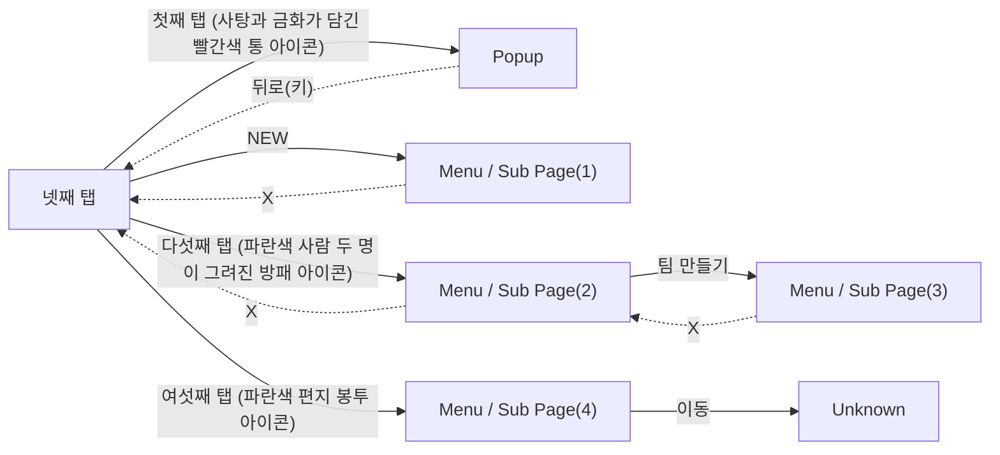

# Game Structure Survey

이 문서는 `game_survey.jsonl`의 화면 캡처와 구조화된 조사 기록으로 생성되었습니다.

## Overview

- Game: Anipang 2 (장르: 매치3 퍼즐)
- Survey records: 22
- Unique screen signatures: 7
- Navigation nodes: 7 (화면 타입별: home 1, menu 4, popup 1, unknown 1)
- ⚠️ 화면 파편화 의심: Menu / Sub Page 4개 (기준 3개 이상). 실제로 서로 다른 화면이면 무시해도 되고, 같은 화면이 쪼개진 것이면 아래 Screen Hierarchy에서 대표 이미지를 비교해 확인하세요.

## Game Structure Diagram

Autodrive가 관찰한 실제 화면 전환입니다. 실선은 루트에서 BFS로 만든 계층(트리), 점선은 트리에 들어가지 않은 교차 링크입니다.

연결선은 실제 전환, `survey only`는 조사 기록에만 있는 화면입니다.

## Screen Hierarchy

루트에서 BFS로 투영한 화면 계층입니다.

- **넷째 탭** (`home`, visits=6)
  - Evidence: navigation/representatives/screen_2537e89ab9ef.png
  - **Popup** (`popup`, visits=4) — via '첫째 탭 (사탕과 금화가 담긴 빨간색 통 아이콘)'
    - Evidence: navigation/representatives/screen_b181d370d396.png
  - **Menu / Sub Page(1)** (`menu`, visits=3) — via 'NEW'
    - Evidence: navigation/representatives/screen_02774c53b0f0.png
  - **Menu / Sub Page(2)** (`menu`, visits=2) — via '다섯째 탭 (파란색 사람 두 명이 그려진 방패 아이콘)'
    - Evidence: navigation/representatives/screen_89fd4deb723b.png
    - **Menu / Sub Page(3)** (`menu`, visits=3) — via '팀 만들기'
      - Evidence: navigation/representatives/screen_316a435e3157.png
  - **Menu / Sub Page(4)** (`menu`, visits=1) — via '여섯째 탭 (파란색 편지 봉투 아이콘)'
    - Evidence: navigation/representatives/screen_da2989b6358d.png
    - **Unknown** (`unknown`, visits=4) — via '이동'
      - Evidence: navigation/representatives/screen_50d8b4a941c2.png

### Cross Links (트리 밖 간선)

- **Popup** (`popup`, visits=4) --(뒤로(키))--> **넷째 탭** (`home`, visits=6)
- **Menu / Sub Page(1)** (`menu`, visits=3) --(X)--> **넷째 탭** (`home`, visits=6)
- **Menu / Sub Page(2)** (`menu`, visits=2) --(X)--> **넷째 탭** (`home`, visits=6)
- **Menu / Sub Page(3)** (`menu`, visits=3) --(X)--> **Menu / Sub Page(2)** (`menu`, visits=2)

## Exploration Frontier

- 탐색 커버리지: 8/17 ((화면,행동) 조합 기준, 눌러본 것/발견한 것, 누르지 않고 정리된 것 5개)

### 아직 안 눌러본 프론티어

- **넷째 탭**: 레벨 1, 설정, 일곱째 탭 (회색 톱니바퀴 아이콘), 일일 보상

### 도달 실패로 포기함(blocked)

- 없음

### 다시 봐도 후보에 안 나와 정리함(not_visible)

- **넷째 탭**: 코드 입력

### 누르기 전 확대 확인에서 못 찾아 정리함(not_found)

- **Menu / Sub Page(3)**: 가입 승인, 자유 가입

### 플레이 진입이라 누르지 않음(play_entry)

- 없음

### 게임 밖·광고·뽑기라 누르지 않음(external)

- **Popup**: 이동하기
- **Menu / Sub Page(4)**: 광고 보기

## Genre Map

장르 화면 지도(`knowledge/map_knowledge.json`)와 실제 구조도를 화면 역할 단위로 대 봤습니다. 역할은 조사 모델이 화면마다 고른 값(`screen_role`)이고, common/often/some은 지도에 적은 대략값(측정치 아님)입니다.

- 역할을 붙인 화면 6/7개, 찾은 역할 5개. 앱 시작·홈에서 플레이·결제·광고·게임 밖을 거치지 않고 갈 수 있는 역할 29개 중 5개.

### 찾은 역할

- 홈(`home`), common: 화면 1개, 근거 분류 progression, currency
- 보상 받기(`reward_popup`), common: 화면 1개, 근거 분류 reward
- 받은편지함(`inbox`), often: 화면 1개, 근거 분류 social, reward
- 상점(`shop`), common: 화면 1개, 근거 분류 monetization, currency — 화면 타입 menu는 지도 후보(shop)에 없음
- 팀·클럽·길드(`team`), common: 화면 2개, 근거 분류 social

### 못 찾은 역할

- common: 로딩(`loading`), 접속 공지·알림(`launch_popup`), 특가·패키지(`offer_popup`), 설명·규칙(`info_popup`), 확인창(`confirm_dialog`), 설정(`settings`), 이벤트(`event_hub`), 광고 보상 제안(`rewarded_ad_offer`), 튜토리얼(`tutorial`), 레벨 시작(`level_start`), 생명 부족·충전(`out_of_lives`)
- often: 로그인·약관(`account_gate`), 출석·일일 보상(`daily_reward`), 도움말·고객센터(`help_support`), 프로필(`profile`), 시즌 패스(`season_pass`), 뽑기·상자·룰렛(`lucky_draw`), 친구(`friends`), 팀 채팅(`team_chat`), 순위표(`leaderboard`), 부스터 설명·구매(`booster_info`)
- some: 꾸미기·건설(`decoration`), 캐릭터 수집·강화(`hero_roster`), 컬렉션·앨범(`collection`)
- 플레이·결제·광고·게임 밖을 거쳐야 갈 수 있음(기본 동작으로는 안 감): 광고 재생(`ad_video`), 플레이(`play`), 일시정지(`pause_menu`), 나가기 확인(`quit_confirm`), 게임 밖(`outside_app`), 이동 수 부족(`out_of_moves`), 레벨 클리어(`level_win`), 레벨 실패(`level_fail`)

### 지도에 없는 전환

역할 사이 전환 중 지도에 없는 것입니다. 역할을 잘못 붙였거나, 게임 밖(에뮬레이터 창 등)으로 나간 흔적이거나, 이 게임만의 구조일 수 있으니 대표 이미지로 확인하세요.

- 홈(`home`) --(첫째 탭 (사탕과 금화가 담긴 빨간색 통 아이콘))--> 보상 받기(`reward_popup`) (`screen_2537e89ab9ef` → `screen_b181d370d396`)
- 보상 받기(`reward_popup`) --(뒤로(키))--> 홈(`home`) (`screen_b181d370d396` → `screen_2537e89ab9ef`)

## Screen Types

- **home**: 게임의 홈 화면으로, 레벨을 선택할 수 있는 지도 형태.
  - Evidence: ../../../captures/2026-11-05_11-34-39_348525_survey_raw.png
- **menu**: 카드 수집과 관련된 상점 화면으로, 카드팩 구매와 보상을 안내하는 내용을 포함한다.
  - Evidence: ../../../captures/2026-11-05_11-35-31_729898_survey_raw.png
- **popup**: 보상 박스 팝업으로 여러 게임들과 관련된 혜택을 소개하며 링크를 제공합니다.
  - Evidence: ../../../captures/2026-11-05_11-34-52_952003_survey_raw.png
- **unknown**: 현재 화면은 게임 UI와 관련이 없는 이미지로, 게임 요소를 포함하고 있지 않음.
  - Evidence: ../../../captures/2026-11-05_11-36-44_996396_survey_raw.png

## Game Elements

이름이 같으면 분류가 달라도 한 항목으로 묶었습니다. 대표 이름은 가장 자주 나온 표기, 대표 분류는 가장 자주 붙은 분류이고, 다른 분류에도 기록됐으면 옆에 적었습니다. 등장 화면은 두 화면 이상일 때만 적습니다.

### account
- 가입 방식 선택
- 가입 조건
- 팀 마크 변경 버튼
- 팀 소개 입력란
- 팀 이름 입력란

### character
- 캐릭터 아이템

### currency
- 보유 포인트

### monetization
- 만들기 버튼
- 인게임 재화(보석)
- 인게임 재화(코인)
- 인게임 재화(하트)
- 카드팩 구매

### reward
- 보상 안내

### ui
- 가입 버튼
- 게임 설정 아이콘
- 레벨 선택
- 메시지 보기 버튼
- 보상 박스 타이틀
- 선물 보기 버튼
- 앱 이동
- 월드 이동
- 이동하기 버튼
- 이벤트 아이콘
- 일일 보상
- 재화 표시 아이콘 (코인, 루비, 하트)
- 카드 수집
- 코인
- 티켓 버튼
- 팀 검색 입력창
- 팀 목록
- 프로필 아이콘
- 하트

## Button And Navigation Candidates

### progression
- 레벨 1 (confidence=1.00) - 레벨 시작 버튼.
- 레벨 2 (confidence=1.00) - 레벨 시작 버튼.
- 레벨 3 (confidence=1.00) - 레벨 시작 버튼.
- 레벨 4 (confidence=1.00) - 레벨 시작 버튼.
- 레벨 5 (confidence=1.00) - 레벨 시작 버튼.
- 이동하기 (confidence=0.90) - 보상 박스의 두 번째 게임으로 이동할 수 있는 버튼입니다.
- 팀 만들기 (confidence=0.90) - 다음 화면으로 진행하는 버튼입니다.
- 자유 가입 (confidence=1.00) - 가입 방식 선택 버튼
- 가입 승인 (confidence=1.00) - 가입 방식 선택 버튼
- 이동 (confidence=0.90) - 링크 이동을 위한 진행 버튼이다.
- 광고 보기 (confidence=0.90) - 광고 보기 버튼으로 보상을 위한 진행이다.

### risky_account
- 무료 보내기 (confidence=1.00) - 회원가입 및 정보를 요구하는 팝업.

### risky_monetization
- 보상받기(애니팡2) (confidence=0.80) - 보상 내용이 포함되어 있어 금전적 거래의 가능성이 있습니다.
- 보상받기(애니팡3) (confidence=0.80) - 보상 내용이 포함되어 있어 금전적 거래의 가능성이 있습니다.
- 보상받기(애니팡 사천성) (confidence=0.80) - 보상 내용이 포함되어 있어 금전적 거래의 가능성이 있습니다.
- 브론즈 (confidence=0.80) - 구매할 수 있는 옵션
- 실버 (confidence=0.80) - 구매할 수 있는 옵션
- 골드 (confidence=0.80) - 구매할 수 있는 옵션
- 만들기 (confidence=1.00) - 팀 생성 시 재화 지불을 요구한다.

### safe_navigation
- 닫기 (confidence=1.00) - 팝업이 전체 화면을 덮고 있기 때문에 사용자에게 닫거나 넘길 필요가 있습니다.
- X (confidence=0.90) - 창을 닫는 버튼

### structure
- 첫째 탭 (사탕과 금화가 담긴 빨간색 통 아이콘) (confidence=1.00) - 탭바 찾기
- 둘째 탭 (파란색, 노란색, 초록색 카드 겹친 아이콘) (confidence=1.00) - 탭바 찾기
- NEW (confidence=1.00) - 탭바 찾기
- 다섯째 탭 (파란색 사람 두 명이 그려진 방패 아이콘) (confidence=1.00) - 탭바 찾기
- 여섯째 탭 (파란색 편지 봉투 아이콘) (confidence=1.00) - 탭바 찾기
- 일곱째 탭 (회색 톱니바퀴 아이콘) (confidence=1.00) - 탭바 찾기
- 설정 (confidence=1.00) - 설정 메뉴 이동 가능.
- 일일 보상 (confidence=1.00) - 일일 보상 관련 유저 인터랙션.
- 코드 입력 (confidence=1.00) - 보상과 관련된 액티비티.
- 카드팩 구매 (confidence=0.80) - 카드팩 구매를 위한 메뉴 영역

## Evidence Index

화면 타입이 바뀌는 지점만 남겼습니다(같은 화면 연속 관찰은 건수로 표시).

- Step 1: home
  - Image: ../../../captures/2026-11-05_11-34-39_348525_survey_raw.png
  - Summary: 게임의 홈 화면으로, 레벨을 선택할 수 있는 지도 형태.
- Step 2–5 (4건): popup
  - Image: ../../../captures/2026-11-05_11-34-52_952003_survey_raw.png
  - Summary: 보상 박스 팝업으로 여러 게임들과 관련된 혜택을 소개하며 링크를 제공합니다.
- Step 6–8 (3건): home
  - Image: navigation/representatives/screen_2537e89ab9ef.png
  - Summary: 게임의 홈 화면으로, 레벨을 선택할 수 있는 지도 형태.
- Step 9–11 (3건): menu
  - Image: ../../../captures/2026-11-05_11-35-31_729898_survey_raw.png
  - Summary: 카드 수집과 관련된 상점 화면으로, 카드팩 구매와 보상을 안내하는 내용을 포함한다.
- Step 12: home
  - Image: navigation/representatives/screen_2537e89ab9ef.png
  - Summary: 게임의 홈 화면으로, 레벨을 선택할 수 있는 지도 형태.
- Step 13–17 (5건): menu
  - Image: ../../../captures/2026-11-05_11-35-59_013904_survey_raw.png
  - Summary: 팀 가입 화면으로, 사용자 팀을 검색하고 가입할 수 있는 목록과 버튼이 있다.
- Step 18: home
  - Image: navigation/representatives/screen_2537e89ab9ef.png
  - Summary: 게임의 홈 화면으로, 레벨을 선택할 수 있는 지도 형태.
- Step 19: menu
  - Image: ../../../captures/2026-11-05_11-36-37_414779_survey_raw.png
  - Summary: 메시지함 화면으로, 광고 및 혜택 정보를 안내하는 내용이 포함되어 있다.
- Step 20–22 (3건): unknown
  - Image: ../../../captures/2026-11-05_11-36-44_996396_survey_raw.png
  - Summary: 현재 화면은 게임 UI와 관련이 없는 이미지로, 게임 요소를 포함하고 있지 않음.
