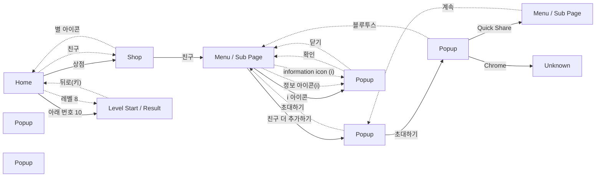

# Game Structure Survey

이 문서는 `game_survey.jsonl`의 화면 캡처와 구조화된 조사 기록으로 생성되었습니다.

## Overview

- Game: Candy Crush Soda Saga (장르: 매치3 퍼즐)
- Survey records: 66
- Unique screen signatures: 12
- Navigation nodes: 11 (화면 타입별: home 1, level 1, menu 2, popup 5, shop 1, unknown 1)
- ⚠️ 화면 파편화 의심: Popup 5개 (기준 3개 이상). 실제로 서로 다른 화면이면 무시해도 되고, 같은 화면이 쪼개진 것이면 아래 Screen Hierarchy에서 대표 이미지를 비교해 확인하세요.

## Game Structure Diagram

Autodrive가 관찰한 실제 화면 전환입니다. 실선은 루트에서 BFS로 만든 계층(트리), 점선은 트리에 들어가지 않은 교차 링크입니다.

연결선은 실제 전환, `survey only`는 조사 기록에만 있는 화면입니다.

## Screen Hierarchy

루트에서 BFS로 투영한 화면 계층입니다.

- **Home** (`home`, visits=9)
  - Evidence: navigation/representatives/screen_0f8eb684abf1.png
  - **Shop** (`shop`, visits=7) — via '상점'
    - Evidence: navigation/representatives/screen_ed79bd0a3f5e.png
    - **Menu / Sub Page** (`menu`, visits=18) — via '친구'
      - Evidence: navigation/representatives/screen_a550b0312d05.png
      - **Popup** (`popup`, visits=9) — via '친구 더 추가하기'
        - Evidence: navigation/representatives/screen_43ecd1bf025f.png
        - **Popup** (`popup`, visits=3) — via '초대하기'
          - Evidence: navigation/representatives/screen_4312ef935c57.png
          - **Menu / Sub Page** (`menu`, visits=1) — via 'Quick Share'
            - Evidence: navigation/representatives/screen_9749095b7573.png
          - **Unknown** (`unknown`, visits=1) — via 'Chrome'
            - Evidence: navigation/representatives/screen_50d8b4a941c2.png
      - **Popup** (`popup`, visits=7) — via 'i 아이콘'
        - Evidence: navigation/representatives/screen_29344fc062d0.png
  - **Level Start / Result** (`level`, visits=12) — via '아래 번호 10'
    - Evidence: navigation/representatives/screen_fb62f06fbee0.png

### 트리에 없는 화면 (루트에서 가는 길을 모름)

관찰은 했지만 루트에서 오는 전환이 기록되지 않아 계층에 넣지 못했습니다. 탐색이 중간에 끊겼거나 화면이 쪼개졌다는 신호입니다.

- **Popup** (`popup`, visits=1)
  - Evidence: navigation/representatives/screen_775834a794f4.png
- **Popup** (`popup`, visits=1)
  - Evidence: navigation/representatives/screen_407184539506.png

### Cross Links (트리 밖 간선)

- **Home** (`home`, visits=9) --(레벨 8)--> **Level Start / Result** (`level`, visits=12)
- **Home** (`home`, visits=9) --(친구)--> **Shop** (`shop`, visits=7)
- **Shop** (`shop`, visits=7) --(별 아이콘)--> **Home** (`home`, visits=9)
- **Level Start / Result** (`level`, visits=12) --(뒤로(키))--> **Home** (`home`, visits=9)
- **Menu / Sub Page** (`menu`, visits=18) --(정보 아이콘(i))--> **Popup** (`popup`, visits=7)
- **Menu / Sub Page** (`menu`, visits=18) --(information icon (i))--> **Popup** (`popup`, visits=7)
- **Popup** (`popup`, visits=9) --(초대하기)--> **Menu / Sub Page** (`menu`, visits=18)
- **Popup** (`popup`, visits=7) --(확인)--> **Menu / Sub Page** (`menu`, visits=18)
- **Popup** (`popup`, visits=7) --(닫기)--> **Menu / Sub Page** (`menu`, visits=18)
- **Popup** (`popup`, visits=3) --(블루투스)--> **Menu / Sub Page** (`menu`, visits=18)
- **Menu / Sub Page** (`menu`, visits=1) --(계속)--> **Popup** (`popup`, visits=9)

## Persistent UI

여러 화면에 같은 모습·같은 자리로 보이는 UI입니다. 공통 버튼은 화면마다가 아니라 한 번만 눌러 보고, 그 결과는 버튼이 보이는 모든 화면에서 지름길로 씁니다.

- 공통 띠: 위 0px, 아래 142px (화면 3개가 공유, 화면 높이 1348px). 같은 화면 판정에서는 이 영역을 빼고 비교합니다.
- 공통 버튼 **상점**: 9개 화면에서 보임, → Shop
- 공통 버튼 **친구**: 7개 화면에서 보임, → Shop
- 공통 버튼 **팀**: 8개 화면에서 보임, not_found
- 공통 버튼 **활동**: 6개 화면에서 보임, not_found
- 공통 버튼 **이벤트**: 5개 화면에서 보임, not_found
- 공통 버튼 **메시지함**: 3개 화면에서 보임, not_found
- 공통 버튼 **별**: 2개 화면에서 보임, 아직 안 눌러 봄

## Exploration Frontier

- 탐색 커버리지: 17/39 ((화면,행동) 조합 기준, 눌러본 것/발견한 것, 누르지 않고 정리된 것 14개)

### 아직 안 눌러본 프론티어

- **공통 버튼(네비게이션 바)**: 별 아이콘
- **Popup**: 계속, 닫기
- **Popup**: 닫기
- **Popup**: 닫기, 업데이트
- **Menu / Sub Page**: 뒤로
- **Shop**: 캘린더 아이콘

### 도달 실패로 포기함(blocked)

- 없음

### 다시 봐도 후보에 안 나와 정리함(not_visible)

- 없음

### 누르기 전 확대 확인에서 못 찾아 정리함(not_found)

- **공통 버튼(네비게이션 바)**: 메시지함, 이벤트, 팀, 활동
- **Popup**: 아이템
- **Unknown**: 홈
- **Shop**: 상점 닫기
- **Level Start / Result**: 부스터 선택

### 플레이 진입이라 누르지 않음(play_entry)

- **Level Start / Result**: 게임 시작!

### 외부 공유·초대라 누르지 않음(external)

- 없음

## Screen Types

- **home**: 게임의 홈 화면으로, 레벨 번호와 관련 버튼들이 배치되어 있다.
  - Evidence: ../../../captures/2026-10-27_01-40-03_921700_survey_raw.png
- **level**: 레벨 시작 화면으로, 목표 및 부스터 선택 기능을 제공하며, 게임 시작 버튼이 있다.
  - Evidence: ../../../captures/2026-10-27_01-43-34_694710_survey_raw.png
- **menu**: 친구와 메시지함 옵션을 제공하는 화면으로, 친구 추가 기능이 있습니다.
  - Evidence: ../../../captures/2026-10-27_01-40-31_936780_survey_raw.png
- **popup**: 친구를 추가하는 안내 창으로, 사용자에게 친구와 함께 플레이를 권장하는 메시지가 포함되어 있다.
  - Evidence: ../../../captures/2026-10-27_01-40-54_096880_survey_raw.png
- **shop**: 게임 내 재화 및 상품 구매 화면으로, 다양한 아이템과 가격이 표시되어 있다.
  - Evidence: ../../../captures/2026-10-27_01-40-19_595983_survey_raw.png
- **unknown**: 화면 구조가 확인되지 않음.
  - Evidence: ../../../captures/2026-10-27_01-44-21_590752_survey_raw.png

## Game Elements

이름이 같으면 분류가 달라도 한 항목으로 묶었습니다. 대표 이름은 가장 자주 나온 표기, 대표 분류는 가장 자주 붙은 분류이고, 다른 분류에도 기록됐으면 옆에 적었습니다. 등장 화면은 두 화면 이상일 때만 적습니다.

### booster
- 부스터 선택

### core_play
- 친구 아이콘

### monetization
- 골드 상품
- 스낵 상품
- 주간 할인

### objective
- 곰돌이를 찾아주세요.

### other
- 하트 보내기 안내

### progression
- 게임 시작 버튼
- 레벨 버튼

### social
- 메시지함
- 친구 추가 안내

### ui
- 가격 표시
- 계속 버튼 — 2개 화면: Menu / Sub Page, Popup
- 닫기 버튼
- 뒤로 버튼
- 메시지함 탭
- 사용 안함 버튼
- 상점 제목
- 설정 아이콘
- 업데이트 버튼
- 재화 아이콘
- 정보 아이콘
- 초대하기 버튼
- 친구 탭
- 캐릭터
- 팝업 종료 버튼
- 폰 이미지
- 하트 아이콘
- 홈 버튼
- 확인 버튼

## Button And Navigation Candidates

### progression
- 아래 번호 10 (confidence=0.90) - 플레이할 레벨 번호이다.
- 레벨 8 (confidence=0.90) - 이전 레벨 번호 8.
- 레벨 9 (confidence=0.90) - 다음 레벨 번호 9.
- 친구 더 추가하기 (confidence=0.95) - Friend addition option on the screen.
- 초대하기 (confidence=0.90) - 다음 화면으로 진행하는 버튼.
- 계속 (confidence=0.90) - 화면 하단 중앙에 위치한 컨티뉴 버튼
- 확인 (confidence=0.90) - 확인 버튼은 다음 화면으로 진행하는 버튼임.
- 업데이트 (confidence=0.95) - 업데이트를 진행하기 위한 버튼이므로 progression으로 분류됨.
- 게임 시작! (confidence=0.85) - 레벨 시작을 위한 진행 버튼.

### risky_monetization
- 구매 아이템 버튼 (confidence=0.90) - 구매 및 결제를 요구하는 상품 아이템.
- 판매 상품 버튼 (confidence=0.80) - 상품 구매를 위해 가격이 표기되어 있다.

### safe_navigation
- 상점 닫기 (confidence=0.95) - 닫기 아이콘은 화면을 정리하기 위한 버튼이다.
- i 아이콘 (confidence=1.00) - 새 화면 나가기 찾기
- 친구 (confidence=0.95) - Tab for friends navigation.
- 메시지함 (confidence=0.95) - Tab for messages navigation.
- X (confidence=0.80) - 팝업을 닫는 버튼.
- 닫기 (confidence=0.90) - 닫기 버튼으로 팝업을 종료할 수 있음
- 뒤로 (confidence=0.90) - 화면 오른쪽 상단에 위치한 뒤로 버튼
- 별 아이콘 (confidence=0.90) - 탭에 위치한 별 버튼
- 캘린더 아이콘 (confidence=0.90) - 탭에 위치한 캘린더 버튼

### structure
- 상점 (confidence=1.00) - 탭바 찾기
- 친구 (confidence=1.00) - 탭바 찾기
- 팀 (confidence=1.00) - 탭바 찾기
- 활동 (confidence=1.00) - 탭바 찾기
- 이벤트 (confidence=1.00) - 탭바 찾기
- 별 (confidence=1.00) - 탭바 찾기
- Quick Share (confidence=1.00) - 탭바 찾기
- 블루투스 (confidence=1.00) - 탭바 찾기
- Chrome (confidence=1.00) - 탭바 찾기
- 메시지함 (confidence=0.80) - 메뉴 탭으로 메시지함으로 이동 가능
- 부스터 선택 (confidence=0.80) - 부스터 옵션을 선택할 수 있는 부분.
- 홈 (confidence=1.00) - 탭바 찾기
- 아이템 (confidence=1.00) - 탭바 찾기

## Evidence Index

화면 타입이 바뀌는 지점만 남겼습니다(같은 화면 연속 관찰은 건수로 표시).

- Step 1: home
  - Image: ../../../captures/2026-10-27_01-40-03_921700_survey_raw.png
  - Summary: 게임의 홈 화면으로, 레벨 번호와 관련 버튼들이 배치되어 있다.
- Step 2: shop
  - Image: ../../../captures/2026-10-27_01-40-19_595983_survey_raw.png
  - Summary: 게임 내 재화 및 상품 구매 화면으로, 다양한 아이템과 가격이 표시되어 있다.
- Step 3–6 (4건): menu
  - Image: ../../../captures/2026-10-27_01-40-31_936780_survey_raw.png
  - Summary: 친구와 메시지함 옵션을 제공하는 화면으로, 친구 추가 기능이 있습니다.
- Step 7–10 (4건): popup
  - Image: ../../../captures/2026-10-27_01-40-54_096880_survey_raw.png
  - Summary: 친구를 추가하는 안내 창으로, 사용자에게 친구와 함께 플레이를 권장하는 메시지가 포함되어 있다.
- Step 11: menu
  - Image: ../../../captures/2026-10-27_01-41-29_347891_survey_raw.png
  - Summary: 계정 및 개인 정보 보호 설정을 선택하는 화면으로, 공유 대상을 설정하는 옵션이 있습니다.
- Step 12–16 (5건): popup
  - Image: navigation/representatives/screen_43ecd1bf025f.png
  - Summary: 친구를 추가하는 안내 창으로, 사용자에게 친구와 함께 플레이를 권장하는 메시지가 포함되어 있다.
- Step 17–18 (2건): menu
  - Image: navigation/representatives/screen_a550b0312d05.png
  - Summary: 친구와 메시지함 옵션을 제공하는 화면으로, 친구 추가 기능이 있습니다.
- Step 19: popup
  - Image: ../../../captures/2026-10-27_01-42-08_428832_survey_raw.png
  - Summary: 친구와 함께 플레이하는 것을 권장하는 안내 창으로, 하트를 보내는 기능에 대한 설명이 포함되어 있다.
- Step 20: menu
  - Image: navigation/representatives/screen_a550b0312d05.png
  - Summary: 친구와 메시지함 옵션을 제공하는 화면으로, 친구 추가 기능이 있습니다.
- Step 21: popup
  - Image: navigation/representatives/screen_29344fc062d0.png
  - Summary: 친구와 함께 플레이하는 것을 권장하는 안내 창으로, 하트를 보내는 기능에 대한 설명이 포함되어 있다.
- Step 22–26 (5건): menu
  - Image: navigation/representatives/screen_a550b0312d05.png
  - Summary: 친구와 메시지함 옵션을 제공하는 화면으로, 친구 추가 기능이 있습니다.
- Step 27: popup
  - Image: navigation/representatives/screen_29344fc062d0.png
  - Summary: 친구와 함께 플레이하는 것을 권장하는 안내 창으로, 하트를 보내는 기능에 대한 설명이 포함되어 있다.
- Step 1: popup
  - Image: ../../../captures/2026-10-27_01-43-19_615294_survey_raw.png
  - Summary: 앱 업데이트를 알리는 안내 창으로, 업데이트 버튼이 있으며, 캐릭터와 함께하는 그래픽 요소가 포함되어 있다.
- Step 2: home
  - Image: navigation/representatives/screen_0f8eb684abf1.png
  - Summary: 게임의 홈 화면으로, 레벨 번호와 관련 버튼들이 배치되어 있다.
- Step 3–7 (5건): level
  - Image: ../../../captures/2026-10-27_01-43-34_694710_survey_raw.png
  - Summary: 레벨 시작 화면으로, 목표 및 부스터 선택 기능을 제공하며, 게임 시작 버튼이 있다.
- Step 8: home
  - Image: navigation/representatives/screen_0f8eb684abf1.png
  - Summary: 게임의 홈 화면으로, 레벨 번호와 관련 버튼들이 배치되어 있다.
- Step 9–10 (2건): shop
  - Image: navigation/representatives/screen_ed79bd0a3f5e.png
  - Summary: 게임 내 재화 및 상품 구매 화면으로, 다양한 아이템과 가격이 표시되어 있다.
- Step 11: menu
  - Image: navigation/representatives/screen_a550b0312d05.png
  - Summary: 친구와 메시지함 옵션을 제공하는 화면으로, 친구 추가 기능이 있습니다.
- Step 12–13 (2건): popup
  - Image: navigation/representatives/screen_43ecd1bf025f.png
  - Summary: 친구를 추가하는 안내 창으로, 사용자에게 친구와 함께 플레이를 권장하는 메시지가 포함되어 있다.
- Step 14: unknown
  - Image: ../../../captures/2026-10-27_01-44-21_590752_survey_raw.png
  - Summary: 화면 구조가 확인되지 않음.
- Step 15: popup
  - Image: ../../../captures/2026-10-27_01-44-32_044786_survey_raw.png
  - Summary: Chrome 알림 설정 안내 팝업으로, 알림을 관리할 수 있는 방법을 제공하며, 사용안함이나 계속 버튼이 있다.
- Step 16: menu
  - Image: navigation/representatives/screen_a550b0312d05.png
  - Summary: 친구와 메시지함 옵션을 제공하는 화면으로, 친구 추가 기능이 있습니다.
- Step 17: popup
  - Image: navigation/representatives/screen_43ecd1bf025f.png
  - Summary: 친구를 추가하는 안내 창으로, 사용자에게 친구와 함께 플레이를 권장하는 메시지가 포함되어 있다.
- Step 18–20 (3건): menu
  - Image: navigation/representatives/screen_a550b0312d05.png
  - Summary: 친구와 메시지함 옵션을 제공하는 화면으로, 친구 추가 기능이 있습니다.
- Step 21: popup
  - Image: navigation/representatives/screen_29344fc062d0.png
  - Summary: 친구와 함께 플레이하는 것을 권장하는 안내 창으로, 하트를 보내는 기능에 대한 설명이 포함되어 있다.
- Step 22: menu
  - Image: navigation/representatives/screen_a550b0312d05.png
  - Summary: 친구와 메시지함 옵션을 제공하는 화면으로, 친구 추가 기능이 있습니다.
- Step 23: popup
  - Image: navigation/representatives/screen_29344fc062d0.png
  - Summary: 친구와 함께 플레이하는 것을 권장하는 안내 창으로, 하트를 보내는 기능에 대한 설명이 포함되어 있다.
- Step 1: home
  - Image: navigation/representatives/screen_0f8eb684abf1.png
  - Summary: 게임의 홈 화면으로, 레벨 번호와 관련 버튼들이 배치되어 있다.
- Step 2–3 (2건): level
  - Image: navigation/representatives/screen_fb62f06fbee0.png
  - Summary: 레벨 시작 화면으로, 목표 및 부스터 선택 기능을 제공하며, 게임 시작 버튼이 있다.
- Step 4: home
  - Image: navigation/representatives/screen_0f8eb684abf1.png
  - Summary: 게임의 홈 화면으로, 레벨 번호와 관련 버튼들이 배치되어 있다.
- Step 5–8 (4건): shop
  - Image: navigation/representatives/screen_ed79bd0a3f5e.png
  - Summary: 게임 내 재화 및 상품 구매 화면으로, 다양한 아이템과 가격이 표시되어 있다.
- Step 9–12 (4건): home
  - Image: navigation/representatives/screen_0f8eb684abf1.png
  - Summary: 게임의 홈 화면으로, 레벨 번호와 관련 버튼들이 배치되어 있다.
- Step 13–16 (4건): level
  - Image: navigation/representatives/screen_fb62f06fbee0.png
  - Summary: 레벨 시작 화면으로, 목표 및 부스터 선택 기능을 제공하며, 게임 시작 버튼이 있다.
