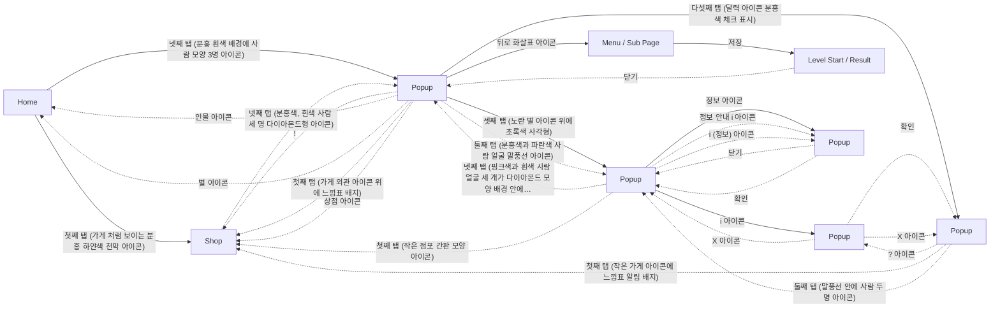

# Game Structure Survey

이 문서는 `game_survey.jsonl`의 화면 캡처와 구조화된 조사 기록으로 생성되었습니다.

## Overview

- Game: Candy Crush Soda Saga (장르: 매치3 퍼즐)
- Survey records: 120
- Unique screen signatures: 15
- Navigation nodes: 9 (화면 타입별: home 1, level 1, menu 1, popup 5, shop 1)
- ⚠️ 화면 파편화 의심: Popup 5개 (기준 3개 이상). 실제로 서로 다른 화면이면 무시해도 되고, 같은 화면이 쪼개진 것이면 아래 Screen Hierarchy에서 대표 이미지를 비교해 확인하세요.

## Game Structure Diagram

Autodrive가 관찰한 실제 화면 전환입니다. 실선은 루트에서 BFS로 만든 계층(트리), 점선은 트리에 들어가지 않은 교차 링크입니다.

연결선은 실제 전환, `survey only`는 조사 기록에만 있는 화면입니다.

## Screen Hierarchy

루트에서 BFS로 투영한 화면 계층입니다.

- **Home** (`home`, visits=5)
  - Evidence: navigation/representatives/screen_8e3bb71d39af.png
  - **Shop** (`shop`, visits=14) — via '첫째 탭 (가게 처럼 보이는 분홍 하얀색 천막 아이콘)'
    - Evidence: navigation/representatives/screen_ed79bd0a3f5e.png
  - **Popup** (`popup`, visits=40) — via '넷째 탭 (분홍 흰색 배경에 사람 모양 3명 아이콘)'
    - Evidence: navigation/representatives/screen_83795821337b.png
    - **Popup** (`popup`, visits=42) — via '셋째 탭 (노란 별 아이콘 위에 초록색 사각형)'
      - Evidence: navigation/representatives/screen_05edc17450ec.png
      - **Popup** (`popup`, visits=5) — via 'i 아이콘'
        - Evidence: navigation/representatives/screen_c671802e4734.png
      - **Popup** (`popup`, visits=4) — via '정보 아이콘'
        - Evidence: navigation/representatives/screen_29344fc062d0.png
    - **Popup** (`popup`, visits=8) — via '다섯째 탭 (달력 아이콘 분홍색 체크 표시)'
      - Evidence: navigation/representatives/screen_e03a03472329.png
    - **Menu / Sub Page** (`menu`, visits=1) — via '뒤로 화살표 아이콘'
      - Evidence: navigation/representatives/screen_dcfcab05030c.png
      - **Level Start / Result** (`level`, visits=1) — via '저장'
        - Evidence: navigation/representatives/screen_df915252ea31.png

### Cross Links (트리 밖 간선)

- **Shop** (`shop`, visits=14) --(넷째 탭 (분홍색, 흰색 사람 세 명 다이아몬드형 아이콘))--> **Popup** (`popup`, visits=40)
- **Popup** (`popup`, visits=40) --(!)--> **Shop** (`shop`, visits=14)
- **Popup** (`popup`, visits=40) --(인물 아이콘)--> **Home** (`home`, visits=5)
- **Popup** (`popup`, visits=40) --(별 아이콘)--> **Home** (`home`, visits=5)
- **Popup** (`popup`, visits=40) --(첫째 탭 (가게 외관 아이콘 위에 느낌표 배지))--> **Shop** (`shop`, visits=14)
- **Popup** (`popup`, visits=40) --(둘째 탭 (분홍색과 파란색 사람 얼굴 말풍선 아이콘))--> **Popup** (`popup`, visits=42)
- **Popup** (`popup`, visits=40) --(상점 아이콘)--> **Shop** (`shop`, visits=14)
- **Popup** (`popup`, visits=42) --(넷째 탭 (핑크색과 흰색 사람 얼굴 세 개가 다이아몬드 모양 배경 안에…)--> **Popup** (`popup`, visits=40)
- **Popup** (`popup`, visits=42) --(첫째 탭 (작은 점포 간판 모양 아이콘))--> **Shop** (`shop`, visits=14)
- **Popup** (`popup`, visits=42) --(정보 안내 i 아이콘)--> **Popup** (`popup`, visits=4)
- **Popup** (`popup`, visits=42) --(i (정보) 아이콘)--> **Popup** (`popup`, visits=4)
- **Popup** (`popup`, visits=8) --(? 아이콘)--> **Popup** (`popup`, visits=5)
- **Popup** (`popup`, visits=8) --(첫째 탭 (작은 가게 아이콘에 느낌표 알림 배지))--> **Shop** (`shop`, visits=14)
- **Popup** (`popup`, visits=8) --(둘째 탭 (말풍선 안에 사람 두 명 아이콘))--> **Popup** (`popup`, visits=42)
- **Popup** (`popup`, visits=5) --(확인)--> **Popup** (`popup`, visits=8)
- **Popup** (`popup`, visits=5) --(X 아이콘)--> **Popup** (`popup`, visits=8)
- **Popup** (`popup`, visits=5) --(X 아이콘)--> **Popup** (`popup`, visits=42)
- **Popup** (`popup`, visits=4) --(닫기)--> **Popup** (`popup`, visits=42)
- **Popup** (`popup`, visits=4) --(확인)--> **Popup** (`popup`, visits=42)
- **Level Start / Result** (`level`, visits=1) --(닫기)--> **Popup** (`popup`, visits=40)

## Persistent UI

여러 화면에 같은 모습·같은 자리로 보이는 UI입니다. 공통 버튼은 화면마다가 아니라 한 번만 눌러 보고, 그 결과는 버튼이 보이는 모든 화면에서 지름길로 씁니다.

- 공통 띠: 위 95px, 아래 143px (화면 3개가 공유, 화면 높이 1348px). 같은 화면 판정에서는 이 영역을 빼고 비교합니다.
- 공통 버튼 **첫째 탭 (가게 처럼 보이는 분홍 하얀색 천막 아이콘)**: 6개 화면에서 보임, → Shop
- 공통 버튼 **둘째 탭 (말풍선 안에 사람 둘 아이콘)**: 6개 화면에서 보임, → Popup
- 공통 버튼 **넷째 탭 (분홍 흰색 배경에 사람 모양 3명 아이콘)**: 4개 화면에서 보임, → Popup
- 공통 버튼 **다섯째 탭 (달력 모양에 체크 표시 아이콘)**: 6개 화면에서 보임, → Popup
- 공통 버튼 **설정**: 3개 화면에서 보임, not_found
- 공통 버튼 **상점**: 2개 화면에서 보임, → Shop
- 공통 버튼 **셋째 탭 (노란 별 아이콘 위에 초록색 사각형)**: 4개 화면에서 보임, → Popup

## Exploration Frontier

- 탐색 커버리지: 21/44 ((화면,행동) 조합 기준, 눌러본 것/발견한 것, 누르지 않고 정리된 것 22개)

### 아직 안 눌러본 프론티어

- **Popup**: 닫기

### 도달 실패로 포기함(blocked)

- **Menu / Sub Page**: 상단 설정 아이콘, 저장, 취소
- **Level Start / Result**: 닫기

### 다시 봐도 후보에 안 나와 정리함(not_visible)

- **Popup**: 닫기
- **Popup**: 닫기 (X), 뒤로(키)

### 누르기 전 확대 확인에서 못 찾아 정리함(not_found)

- **공통 버튼(네비게이션 바)**: 설정 아이콘
- **Popup**: 경고 아이콘, 달력 아이콘, 별 아이콘
- **Popup**: 달력 아이콘
- **Shop**: 상점 닫기

### 플레이 진입이라 누르지 않음(play_entry)

- **Popup**: 플레이
- **Level Start / Result**: 게임 시작!
- **Popup**: 플레이

### 외부 공유·초대라 누르지 않음(external)

- **Popup**: 친구 더 추가

## Screen Types

- **home**: 게임의 중심 화면으로 보드와 레벨 정보가 포함됨.
  - Evidence: ../../../captures/2026-10-27_05-44-43_361742_survey_raw.png
- **level**: 레벨 시작 화면으로, 목표와 부스터 선택을 안내하는 팝업이 나타나고, 게임 시작 버튼이 있는 구조입니다.
  - Evidence: ../../../captures/2026-10-27_05-48-25_177904_survey_raw.png
- **menu**: 게임 설정 메뉴 화면으로, 디스플레이 설정을 조정할 수 있는 옵션이 포함되어 있습니다.
  - Evidence: ../../../captures/2026-10-27_05-48-12_074962_survey_raw.png
- **popup**: 팀 관련 정보를 안내하는 팝업 화면.
  - Evidence: ../../../captures/2026-10-27_05-45-20_810247_survey_raw.png
- **shop**: 아이템 구매를 위한 상점 화면.
  - Evidence: ../../../captures/2026-10-27_05-44-57_244460_survey_raw.png

## Game Elements

이름이 같으면 분류가 달라도 한 항목으로 묶었습니다. 대표 이름은 가장 자주 나온 표기, 대표 분류는 가장 자주 붙은 분류이고, 다른 분류에도 기록됐으면 옆에 적었습니다. 등장 화면은 두 화면 이상일 때만 적습니다.

### booster
- 부스터 선택

### core_play
- 목표
- 안내 메시지
- 플레이 버튼 (분류 중복: ui)

### currency
- 골드

### monetization
- 골드 특가
- 주간 할인
- 특별 상품

### other
- 캐릭터 이미지

### progression
- 게임 시작

### social
- 친구 도움 안내

### ui
- 닫기 아이콘
- 디스플레이 설정
- 레벨 번호
- 보스 아이콘
- 생명 (하트)
- 성공률
- 재화 (골드)
- 재화 안내 아이콘
- 저장 버튼
- 취소 버튼
- 친구 더 추가 버튼
- 친구 탭
- 탭바
- 팀 팝업 아이콘
- 팝업 내용
- 확인 버튼
- 활동 안내 제목

## Button And Navigation Candidates

### progression
- 플레이 (confidence=0.95) - 팀 팝업 진행을 위한 플레이 버튼.
- 친구 더 추가 (confidence=0.80) - 팝업 하단에 진행 버튼으로 보임.
- 확인 (confidence=0.90) - 사용자가 확인 버튼을 눌러 다음으로 진행할 수 있다.
- 게임 시작! (confidence=0.90) - 게임을 시작하는 버튼

### risky_monetization
- ₩5,500 (confidence=1.00) - 구매 버튼으로 가격이 표시됨.
- 10 (confidence=1.00) - 구매 가능한 아이템 수량.
- 30 (confidence=1.00) - 구매 가능한 아이템 수량.
- 60 (confidence=1.00) - 구매 가능한 아이템 수량.

### safe_navigation
- 상점 닫기 (confidence=1.00) - X 아이콘으로 상점 닫기 역할.
- 닫기 (X) (confidence=0.90) - 팝업 화면 상단의 닫기 버튼.
- i 아이콘 (confidence=1.00) - 새 화면 나가기 찾기
- 닫기 (confidence=0.90) - 닫기 버튼이 화면 상단에 위치함.
- ? 아이콘 (confidence=0.70) - 정보 제공 화면으로 이동을 위한 버튼.
- X 아이콘 (confidence=1.00) - 새 화면 나가기 찾기
- 친구 (confidence=0.80) - 탭을 통해 친구 섹션으로 이동.
- 메시지함 (confidence=0.80) - 탭을 통해 메시지함으로 이동.
- 경고 아이콘 (confidence=0.80) - 탭을 통해 알림을 확인.
- 별 아이콘 (confidence=0.80) - 탭을 통해 보상을 확인.
- 달력 아이콘 (confidence=0.80) - 탭을 통해 일정 확인.
- ! (confidence=0.80) - 알림 관련 아이콘.
- 인물 아이콘 (confidence=0.80) - 팀 관련 구성원 정보.
- 상점 아이콘 (confidence=0.85) - 탭바의 첫 번째 아이콘으로 상점으로 이동하는 역할.
- 팀 아이콘 (confidence=0.85) - 탭바의 네 번째 아이콘으로 팀 관련 기능으로 이동하는 역할.
- 설정 아이콘 (confidence=0.80) - 탭바에 위치한 버튼이다.

### structure
- 첫째 탭 (가게 처럼 보이는 분홍 하얀색 천막 아이콘) (confidence=1.00) - 탭바 찾기
- 둘째 탭 (말풍선 안에 사람 둘 아이콘) (confidence=1.00) - 탭바 찾기
- 넷째 탭 (분홍 흰색 배경에 사람 모양 3명 아이콘) (confidence=1.00) - 탭바 찾기
- 다섯째 탭 (달력 모양에 체크 표시 아이콘) (confidence=1.00) - 탭바 찾기
- 설정 (confidence=0.95) - 우측 상단에 위치한 설정 아이콘.
- 상점 (confidence=1.00) - 탭바 찾기
- 둘째 탭 (분홍색, 파란색 사람 두 명 말풍선 아이콘) (confidence=1.00) - 탭바 찾기
- 넷째 탭 (분홍색, 흰색 사람 세 명 다이아몬드형 아이콘) (confidence=1.00) - 탭바 찾기
- 다섯째 탭 (분홍색 체크 표시 달력 아이콘) (confidence=1.00) - 탭바 찾기
- 첫째 탭 (가게 외관 아이콘 위에 느낌표 배지) (confidence=1.00) - 탭바 찾기
- 둘째 탭 (분홍색과 파란색 사람 얼굴 말풍선 아이콘) (confidence=1.00) - 탭바 찾기
- 셋째 탭 (노란 별 아이콘 위에 초록색 사각형) (confidence=1.00) - 탭바 찾기
- 다섯째 탭 (달력 아이콘 분홍색 체크 표시) (confidence=1.00) - 탭바 찾기
- 첫째 탭 (작은 점포 간판 모양 아이콘) (confidence=1.00) - 탭바 찾기
- 셋째 탭 (노란 별 아이콘) (confidence=1.00) - 탭바 찾기
- 넷째 탭 (핑크색과 흰색 사람 얼굴 세 개가 다이아몬드 모양 배경 안에… (confidence=1.00) - 탭바 찾기
- 다섯째 탭 (달력에 체크표시 아이콘) (confidence=1.00) - 탭바 찾기
- 첫째 탭 (작은 가게 아이콘에 느낌표 알림 배지) (confidence=1.00) - 탭바 찾기
- 둘째 탭 (말풍선 안에 사람 두 명 아이콘) (confidence=1.00) - 탭바 찾기
- 셋째 탭 (별 아이콘이 놓인 보드 아이콘) (confidence=1.00) - 탭바 찾기
- 넷째 탭 (다른 모양 타원 안에 사람 세 명 아이콘) (confidence=1.00) - 탭바 찾기
- 활동 (confidence=1.00) - 탭바 찾기
- 첫째 탭 (상점 아이콘) (confidence=1.00) - 탭바 찾기
- 둘째 탭 (말풍선 안의 사람 두 명 아이콘) (confidence=1.00) - 탭바 찾기
- 셋째 탭 (별 아이콘) (confidence=1.00) - 탭바 찾기
- 다섯째 탭 (달력 아이콘) (confidence=1.00) - 탭바 찾기
- 저장 (confidence=0.90) - 변경 사항을 저장하는 버튼.
- 취소 (confidence=0.90) - 변경 사항을 취소하는 버튼.
- 상단 설정 아이콘 (confidence=0.80) - 기타 설정으로 돌아가는 버튼.
- 첫째 탭 (상점 천막 아이콘) (confidence=1.00) - 탭바 찾기
- 둘째 탭 (말풍선 속 사람 두 명 아이콘) (confidence=1.00) - 탭바 찾기
- 넷째 탭 (구름 속 사람 모양 아이콘) (confidence=1.00) - 탭바 찾기
- 다섯째 탭 (달력에 체크 표시 아이콘) (confidence=1.00) - 탭바 찾기

## Evidence Index

화면 타입이 바뀌는 지점만 남겼습니다(같은 화면 연속 관찰은 건수로 표시).

- Step 1: home
  - Image: ../../../captures/2026-10-27_05-44-43_361742_survey_raw.png
  - Summary: 게임의 중심 화면으로 보드와 레벨 정보가 포함됨.
- Step 2–6 (5건): shop
  - Image: ../../../captures/2026-10-27_05-44-57_244460_survey_raw.png
  - Summary: 아이템 구매를 위한 상점 화면.
- Step 7–16 (10건): popup
  - Image: ../../../captures/2026-10-27_05-45-20_810247_survey_raw.png
  - Summary: 팀 관련 정보를 안내하는 팝업 화면.
- Step 17–18 (2건): shop
  - Image: navigation/representatives/screen_ed79bd0a3f5e.png
  - Summary: 아이템 구매를 위한 상점 화면.
- Step 19–38 (20건): popup
  - Image: navigation/representatives/screen_83795821337b.png
  - Summary: 팀 관련 정보를 안내하는 팝업 화면.
- Step 39–40 (2건): shop
  - Image: navigation/representatives/screen_ed79bd0a3f5e.png
  - Summary: 아이템 구매를 위한 상점 화면.
- Step 1–4 (4건): popup
  - Image: navigation/representatives/screen_83795821337b.png
  - Summary: 팀 관련 정보를 안내하는 팝업 화면.
- Step 5: menu
  - Image: ../../../captures/2026-10-27_05-48-12_074962_survey_raw.png
  - Summary: 게임 설정 메뉴 화면으로, 디스플레이 설정을 조정할 수 있는 옵션이 포함되어 있습니다.
- Step 6: level
  - Image: ../../../captures/2026-10-27_05-48-25_177904_survey_raw.png
  - Summary: 레벨 시작 화면으로, 목표와 부스터 선택을 안내하는 팝업이 나타나고, 게임 시작 버튼이 있는 구조입니다.
- Step 7–12 (6건): popup
  - Image: navigation/representatives/screen_83795821337b.png
  - Summary: 팀 관련 정보를 안내하는 팝업 화면.
- Step 13: shop
  - Image: navigation/representatives/screen_ed79bd0a3f5e.png
  - Summary: 아이템 구매를 위한 상점 화면.
- Step 14: popup
  - Image: navigation/representatives/screen_83795821337b.png
  - Summary: 팀 관련 정보를 안내하는 팝업 화면.
- Step 15–16 (2건): home
  - Image: navigation/representatives/screen_8e3bb71d39af.png
  - Summary: 게임의 중심 화면으로 보드와 레벨 정보가 포함됨.
- Step 17: popup
  - Image: navigation/representatives/screen_83795821337b.png
  - Summary: 팀 관련 정보를 안내하는 팝업 화면.
- Step 18: home
  - Image: navigation/representatives/screen_8e3bb71d39af.png
  - Summary: 게임의 중심 화면으로 보드와 레벨 정보가 포함됨.
- Step 19–23 (5건): popup
  - Image: navigation/representatives/screen_83795821337b.png
  - Summary: 팀 관련 정보를 안내하는 팝업 화면.
- Step 24: shop
  - Image: navigation/representatives/screen_ed79bd0a3f5e.png
  - Summary: 아이템 구매를 위한 상점 화면.
- Step 25–30 (6건): popup
  - Image: navigation/representatives/screen_83795821337b.png
  - Summary: 팀 관련 정보를 안내하는 팝업 화면.
- Step 31: home
  - Image: navigation/representatives/screen_8e3bb71d39af.png
  - Summary: 게임의 중심 화면으로 보드와 레벨 정보가 포함됨.
- Step 32–36 (5건): popup
  - Image: navigation/representatives/screen_83795821337b.png
  - Summary: 팀 관련 정보를 안내하는 팝업 화면.
- Step 37: shop
  - Image: navigation/representatives/screen_ed79bd0a3f5e.png
  - Summary: 아이템 구매를 위한 상점 화면.
- Step 38–40 (3건): popup
  - Image: navigation/representatives/screen_83795821337b.png
  - Summary: 팀 관련 정보를 안내하는 팝업 화면.
- Step 1–18 (18건): popup
  - Image: navigation/representatives/screen_05edc17450ec.png
  - Summary: 팀 관련 정보를 안내하는 팝업 화면.
- Step 19–20 (2건): shop
  - Image: navigation/representatives/screen_ed79bd0a3f5e.png
  - Summary: 아이템 구매를 위한 상점 화면.
- Step 21–40 (20건): popup
  - Image: navigation/representatives/screen_83795821337b.png
  - Summary: 팀 관련 정보를 안내하는 팝업 화면.
