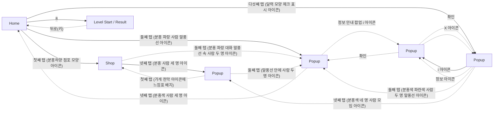

# Game Structure Survey

이 문서는 `game_survey.jsonl`의 화면 캡처와 구조화된 조사 기록으로 생성되었습니다.

## Overview

- Game: Candy Crush Soda Saga (장르: 매치3 퍼즐)
- Survey records: 73
- Unique screen signatures: 8
- Navigation nodes: 7 (화면 타입별: home 1, level 1, popup 4, shop 1)
- ⚠️ 화면 파편화 의심: Popup 4개 (기준 3개 이상). 실제로 서로 다른 화면이면 무시해도 되고, 같은 화면이 쪼개진 것이면 아래 Screen Hierarchy에서 대표 이미지를 비교해 확인하세요.

## Game Structure Diagram

Autodrive가 관찰한 실제 화면 전환입니다. 실선은 루트에서 BFS로 만든 계층(트리), 점선은 트리에 들어가지 않은 교차 링크입니다.

연결선은 실제 전환, `survey only`는 조사 기록에만 있는 화면입니다.

## Screen Hierarchy

루트에서 BFS로 투영한 화면 계층입니다.

- **Home** (`home`, visits=7)
  - Evidence: navigation/representatives/screen_d572489ed840.png
  - **Shop** (`shop`, visits=3) — via '첫째 탭 (분홍하양 점포 모양 아이콘)'
    - Evidence: navigation/representatives/screen_6d42d2b6afc7.png
    - **Popup** (`popup`, visits=3) — via '넷째 탭 (분홍 사람 세 명 아이콘)'
      - Evidence: navigation/representatives/screen_342f44ba678a.png
  - **Popup** (`popup`, visits=9) — via '다섯째 탭 (달력 모양 체크 표시 아이콘)'
    - Evidence: navigation/representatives/screen_e1867978482d.png
    - **Popup** (`popup`, visits=18) — via 'i 아이콘'
      - Evidence: navigation/representatives/screen_29344fc062d0.png
  - **Level Start / Result** (`level`, visits=16) — via '8'
    - Evidence: navigation/representatives/screen_c8c659d7caac.png
  - **Popup** (`popup`, visits=17) — via '둘째 탭 (분홍 파랑 사람 말풍선 아이콘)'
    - Evidence: navigation/representatives/screen_6ade807b4348.png

### Cross Links (트리 밖 간선)

- **Shop** (`shop`, visits=3) --(둘째 탭 (분홍 파랑 대화 말풍선 속 사람 두 명 아이콘))--> **Popup** (`popup`, visits=17)
- **Popup** (`popup`, visits=9) --(정보 아이콘)--> **Popup** (`popup`, visits=18)
- **Popup** (`popup`, visits=9) --(둘째 탭 (분홍색 파란색 사람 두 명 말풍선 아이콘))--> **Popup** (`popup`, visits=17)
- **Popup** (`popup`, visits=9) --(넷째 탭 (분홍색 네 명 사람 모임 아이콘))--> **Popup** (`popup`, visits=3)
- **Level Start / Result** (`level`, visits=16) --(뒤로(키))--> **Home** (`home`, visits=7)
- **Popup** (`popup`, visits=17) --(넷째 탭 (분홍색 사람 세 명 아이콘))--> **Home** (`home`, visits=7)
- **Popup** (`popup`, visits=17) --(정보 안내 팝업 i 아이콘)--> **Popup** (`popup`, visits=18)
- **Popup** (`popup`, visits=3) --(첫째 탭 (가게 천막 아이콘에 느낌표 배지))--> **Shop** (`shop`, visits=3)
- **Popup** (`popup`, visits=3) --(둘째 탭 (말풍선 안에 사람 두 명 아이콘))--> **Popup** (`popup`, visits=17)
- **Popup** (`popup`, visits=18) --(확인)--> **Popup** (`popup`, visits=9)
- **Popup** (`popup`, visits=18) --(X 아이콘)--> **Popup** (`popup`, visits=9)
- **Popup** (`popup`, visits=18) --(확인)--> **Popup** (`popup`, visits=17)

## Persistent UI

여러 화면에 같은 모습·같은 자리로 보이는 UI입니다. 공통 버튼은 화면마다가 아니라 한 번만 눌러 보고, 그 결과는 버튼이 보이는 모든 화면에서 지름길로 씁니다.

- 공통 띠: 위 95px, 아래 151px (화면 3개가 공유, 화면 높이 1348px). 같은 화면 판정에서는 이 영역을 빼고 비교합니다.
- 공통 버튼 **첫째 탭 (분홍하양 점포 모양 아이콘)**: 4개 화면에서 보임, → Shop
- 공통 버튼 **둘째 탭 (분홍 파랑 사람 말풍선 아이콘)**: 4개 화면에서 보임, → Popup
- 공통 버튼 **넷째 탭 (분홍 사람 3명 다이아몬드 아이콘)**: 5개 화면에서 보임, → Home
- 공통 버튼 **다섯째 탭 (달력 모양 체크 표시 아이콘)**: 4개 화면에서 보임, → Popup
- 공통 버튼 **셋째 탭 (노란 별이 초록 사각판 위에 있는 아이콘)**: 4개 화면에서 보임, → __global__
- 공통 버튼 **친구**: 2개 화면에서 보임, → __global__

## Exploration Frontier

- 탐색 커버리지: 21/30 ((화면,행동) 조합 기준, 눌러본 것/발견한 것, 누르지 않고 정리된 것 9개)

### 아직 안 눌러본 프론티어

- 없음 — 발견한 모든 (화면,행동)을 처리했습니다.

### 도달 실패로 포기함(blocked)

- 없음

### 다시 봐도 후보에 안 나와 정리함(not_visible)

- 없음

### 누르기 전 확대 확인에서 못 찾아 정리함(not_found)

- 없음

### 플레이 진입이라 누르지 않음(play_entry)

- **Popup**: 플레이
- **Level Start / Result**: 게임 시작!
- **Popup**: 플레이

### 외부 공유·초대라 누르지 않음(external)

- **Popup**: 친구 더 추가하기

## Screen Types

- **home**: 홈 화면에서 레벨 선택 및 게임 진행 상태를 보여줌. 주요 정보 제공.
  - Evidence: ../../../captures/2026-10-27_06-36-06_568075_survey_raw.png
- **level**: 레벨 시작 화면으로, 목표와 부스터 선택을 제공.
  - Evidence: ../../../captures/2026-10-27_06-38-12_311123_survey_raw.png
- **popup**: 친구에 관한 안내 팝업으로, 친구와 함께 플레이할 때의 장점 설명.
  - Evidence: ../../../captures/2026-10-27_06-36-38_330578_survey_raw.png
- **shop**: 게임 내 구매 화면으로, 다양한 아이템과 패키지를 보여줌.
  - Evidence: ../../../captures/2026-10-27_06-36-23_146771_survey_raw.png

## Game Elements

이름이 같으면 분류가 달라도 한 항목으로 묶었습니다. 대표 이름은 가장 자주 나온 표기, 대표 분류는 가장 자주 붙은 분류이고, 다른 분류에도 기록됐으면 옆에 적었습니다. 등장 화면은 두 화면 이상일 때만 적습니다.

### character
- 오징어 캐릭터

### currency
- Gold
- Life

### monetization
- 골드 특가
- 구매 가격
- 특별 상품
- 한정 혜택

### objective
- Level Indicator
- 목표: 곰돌이를 찾아주세요.

### other
- 캐릭터(인어)

### progression
- 게임 시작 버튼

### reward
- Prize Box

### ui
- Home Button
- 닫기 버튼 — 2개 화면: Level Start / Result, Popup
- 레벨 번호 표시
- 목표 안내 세부 사항
- 부스터 선택
- 정보 아이콘
- 친구 더 추가하기 버튼
- 친구 팝업
- 탭바 — 3개 화면: Level Start / Result, Popup, Shop
- 플레이 버튼
- 확인 버튼

## Button And Navigation Candidates

### progression
- 8 (confidence=0.80) - 레벨 선택 버튼 중 하나로 진행을 의미.
- 9 (confidence=0.80) - 레벨 선택 버튼 중 하나로 진행을 의미.
- 10 (confidence=0.80) - 레벨 선택 버튼 중 하나로 진행을 의미.
- 친구 더 추가하기 (confidence=1.00) - 진행을 위한 버튼
- 플레이 (confidence=0.90) - 게임을 진행하기 위한 버튼.
- 확인 (confidence=0.90) - 보상 수락을 위한 진행 버튼.
- 게임 시작! (confidence=0.95) - 게임 시작을 위한 버튼.

### safe_navigation
- 정보 안내 팝업 i 아이콘 (confidence=1.00) - 새 화면 나가기 찾기
- 친구 (confidence=1.00) - 탭 네비게이션 버튼
- 메시지함 (confidence=1.00) - 탭 네비게이션 버튼
- i 아이콘 (confidence=1.00) - 새 화면 나가기 찾기
- 정보 아이콘 (confidence=0.80) - 팝업 내용에 대한 추가 정보를 제공.
- X 아이콘 (confidence=0.90) - 팝업을 닫기 위한 버튼.
- 닫기 (confidence=0.95) - 팝업의 닫기 버튼.

### structure
- 첫째 탭 (분홍하양 점포 모양 아이콘) (confidence=1.00) - 탭바 찾기
- 둘째 탭 (분홍 파랑 사람 말풍선 아이콘) (confidence=1.00) - 탭바 찾기
- 넷째 탭 (분홍 사람 3명 다이아몬드 아이콘) (confidence=1.00) - 탭바 찾기
- 다섯째 탭 (달력 모양 체크 표시 아이콘) (confidence=1.00) - 탭바 찾기
- 둘째 탭 (분홍 파랑 대화 말풍선 속 사람 두 명 아이콘) (confidence=1.00) - 탭바 찾기
- 셋째 탭 (노란 별이 초록 사각판 위에 있는 아이콘) (confidence=1.00) - 탭바 찾기
- 넷째 탭 (분홍 사람 세 명 아이콘) (confidence=1.00) - 탭바 찾기
- 다섯째 탭 (달력 아이콘) (confidence=1.00) - 탭바 찾기
- 첫째 탭 (분홍색·하늘색 줄무늬 지붕 아이콘) (confidence=1.00) - 탭바 찾기
- 셋째 탭 (노란색 별 아이콘) (confidence=1.00) - 탭바 찾기
- 넷째 탭 (분홍색 사람 세 명 아이콘) (confidence=1.00) - 탭바 찾기
- 다섯째 탭 (분홍색 확인 표시 달력 아이콘) (confidence=1.00) - 탭바 찾기
- 첫째 탭 (작은 가게 천막 아이콘에 빨간 느낌표) (confidence=1.00) - 탭바 찾기
- 둘째 탭 (분홍색 파란색 사람 두 명 말풍선 아이콘) (confidence=1.00) - 탭바 찾기
- 셋째 탭 (노란 별 아이콘) (confidence=1.00) - 탭바 찾기
- 넷째 탭 (분홍색 네 명 사람 모임 아이콘) (confidence=1.00) - 탭바 찾기
- 활동 (confidence=0.70) - 현재 활동의 제목으로 사용.
- 홈 (confidence=1.00) - 탭바 찾기
- 연습 (confidence=1.00) - 탭바 찾기
- 넷째 탭 (메달 아이콘) (confidence=1.00) - 탭바 찾기
- 상점 (confidence=1.00) - 탭바 찾기
- 스토어 (confidence=1.00) - 탭바 찾기
- 친구 (confidence=1.00) - 탭바 찾기
- 체크표시 (confidence=1.00) - 탭바 찾기
- 첫째 탭 (가게 천막 아이콘에 느낌표 배지) (confidence=1.00) - 탭바 찾기
- 둘째 탭 (말풍선 안에 사람 두 명 아이콘) (confidence=1.00) - 탭바 찾기
- 셋째 탭 (별 모양 아이콘) (confidence=1.00) - 탭바 찾기
- 다섯째 탭 (달력 모양 아이콘에 체크 표시) (confidence=1.00) - 탭바 찾기

## Evidence Index

화면 타입이 바뀌는 지점만 남겼습니다(같은 화면 연속 관찰은 건수로 표시).

- Step 1: home
  - Image: ../../../captures/2026-10-27_06-36-06_568075_survey_raw.png
  - Summary: 홈 화면에서 레벨 선택 및 게임 진행 상태를 보여줌. 주요 정보 제공.
- Step 2: shop
  - Image: ../../../captures/2026-10-27_06-36-23_146771_survey_raw.png
  - Summary: 게임 내 구매 화면으로, 다양한 아이템과 패키지를 보여줌.
- Step 3–5 (3건): popup
  - Image: ../../../captures/2026-10-27_06-36-38_330578_survey_raw.png
  - Summary: 친구에 관한 안내 팝업으로, 친구와 함께 플레이할 때의 장점 설명.
- Step 6: home
  - Image: navigation/representatives/screen_d572489ed840.png
  - Summary: 홈 화면에서 레벨 선택 및 게임 진행 상태를 보여줌. 주요 정보 제공.
- Step 7–24 (18건): popup
  - Image: ../../../captures/2026-10-27_06-37-00_045238_survey_raw.png
  - Summary: 활동 참여와 보상을 안내하는 팝업 화면.
- Step 25: home
  - Image: navigation/representatives/screen_d572489ed840.png
  - Summary: 홈 화면에서 레벨 선택 및 게임 진행 상태를 보여줌. 주요 정보 제공.
- Step 26–34 (9건): level
  - Image: ../../../captures/2026-10-27_06-38-12_311123_survey_raw.png
  - Summary: 레벨 시작 화면으로, 목표와 부스터 선택을 제공.
- Step 35: home
  - Image: navigation/representatives/screen_d572489ed840.png
  - Summary: 홈 화면에서 레벨 선택 및 게임 진행 상태를 보여줌. 주요 정보 제공.
- Step 36–40 (5건): popup
  - Image: navigation/representatives/screen_6ade807b4348.png
  - Summary: 친구에 관한 안내 팝업으로, 친구와 함께 플레이할 때의 장점 설명.
- Step 1: popup
  - Image: navigation/representatives/screen_6ade807b4348.png
  - Summary: 친구에 관한 안내 팝업으로, 친구와 함께 플레이할 때의 장점 설명.
- Step 2: home
  - Image: navigation/representatives/screen_d572489ed840.png
  - Summary: 홈 화면에서 레벨 선택 및 게임 진행 상태를 보여줌. 주요 정보 제공.
- Step 3–14 (12건): popup
  - Image: navigation/representatives/screen_e1867978482d.png
  - Summary: 활동 참여와 보상을 안내하는 팝업 화면.
- Step 15: shop
  - Image: navigation/representatives/screen_6d42d2b6afc7.png
  - Summary: 게임 내 구매 화면으로, 다양한 아이템과 패키지를 보여줌.
- Step 16: popup
  - Image: navigation/representatives/screen_342f44ba678a.png
  - Summary: 팀원과 협력할 것을 독려하는 안내 팝업으로, 팀 지원과 레벨 도달 목표를 제시하고 있다.
- Step 17: shop
  - Image: navigation/representatives/screen_6d42d2b6afc7.png
  - Summary: 게임 내 구매 화면으로, 다양한 아이템과 패키지를 보여줌.
- Step 18–19 (2건): popup
  - Image: navigation/representatives/screen_342f44ba678a.png
  - Summary: 팀원과 협력할 것을 독려하는 안내 팝업으로, 팀 지원과 레벨 도달 목표를 제시하고 있다.
- Step 20: home
  - Image: navigation/representatives/screen_d572489ed840.png
  - Summary: 홈 화면에서 레벨 선택 및 게임 진행 상태를 보여줌. 주요 정보 제공.
- Step 21–25 (5건): popup
  - Image: navigation/representatives/screen_6ade807b4348.png
  - Summary: 친구에 관한 안내 팝업으로, 친구와 함께 플레이할 때의 장점 설명.
- Step 26: home
  - Image: navigation/representatives/screen_d572489ed840.png
  - Summary: 홈 화면에서 레벨 선택 및 게임 진행 상태를 보여줌. 주요 정보 제공.
- Step 27–33 (7건): level
  - Image: navigation/representatives/screen_c8c659d7caac.png
  - Summary: 레벨 시작 화면으로, 목표와 부스터 선택을 제공.
