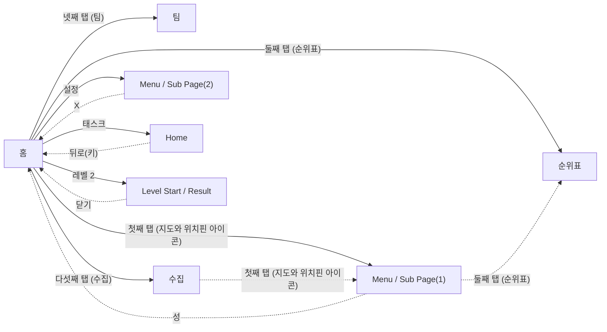

# Game Structure Survey

이 문서는 `game_survey.jsonl`의 화면 캡처와 구조화된 조사 기록으로 생성되었습니다.

## Overview

- Game: Dream Mania (장르: 매치3 퍼즐)
- Survey records: 40
- Unique screen signatures: 8
- Navigation nodes: 8 (화면 타입별: home 2, level 1, menu 5)
- ⚠️ 화면 파편화 의심: Menu / Sub Page 5개 (기준 3개 이상). 실제로 서로 다른 화면이면 무시해도 되고, 같은 화면이 쪼개진 것이면 아래 Screen Hierarchy에서 대표 이미지를 비교해 확인하세요.

## Game Structure Diagram

Autodrive가 관찰한 실제 화면 전환입니다. 실선은 루트에서 BFS로 만든 계층(트리), 점선은 트리에 들어가지 않은 교차 링크입니다.

연결선은 실제 전환, `survey only`는 조사 기록에만 있는 화면입니다.
탭 화면은 루트 아래 탭 순서대로 두고, 탭 화면끼리 오간 간선 3개는 그리지 않았습니다(탭바로 어느 탭에서나 서로 갈 수 있음).

## Screen Hierarchy

루트에서 BFS로 투영한 화면 계층입니다.

- **홈** (`home`, visits=7)
  - Evidence: navigation/representatives/screen_dfd9a6abae25.png
  - **순위표** (`menu`, visits=5) — via '둘째 탭 (순위표)'
    - Evidence: navigation/representatives/screen_6deea0a55911.png
  - **팀** (`menu`, visits=5) — via '넷째 탭 (팀)'
    - Evidence: navigation/representatives/screen_059432a5a347.png
  - **수집** (`menu`, visits=4) — via '다섯째 탭 (수집)'
    - Evidence: navigation/representatives/screen_3086ff05cdbf.png
  - **Menu / Sub Page(1)** (`menu`, visits=9) — via '첫째 탭 (지도와 위치핀 아이콘)'
    - Evidence: navigation/representatives/screen_dc59b68ac442.png
  - **Menu / Sub Page(2)** (`menu`, visits=4) — via '설정'
    - Evidence: navigation/representatives/screen_020d8f6e6efe.png
  - **Home** (`home`, visits=5) — via '태스크'
    - Evidence: navigation/representatives/screen_ff9390954fb6.png
  - **Level Start / Result** (`level`, visits=1) — via '레벨 2'
    - Evidence: navigation/representatives/screen_74d6591e8133.png

### Cross Links (트리 밖 간선)

- **수집** (`menu`, visits=4) --(첫째 탭 (지도와 위치핀 아이콘))--> **Menu / Sub Page(1)** (`menu`, visits=9)
- **Menu / Sub Page(1)** (`menu`, visits=9) --(둘째 탭 (순위표))--> **순위표** (`menu`, visits=5)
- **Menu / Sub Page(1)** (`menu`, visits=9) --(성)--> **홈** (`home`, visits=7)
- **Menu / Sub Page(2)** (`menu`, visits=4) --(X)--> **홈** (`home`, visits=7)
- **Home** (`home`, visits=5) --(뒤로(키))--> **홈** (`home`, visits=7)
- **Level Start / Result** (`level`, visits=1) --(닫기)--> **홈** (`home`, visits=7)

## Persistent UI

여러 화면에 같은 모습·같은 자리로 보이는 UI입니다. 공통 버튼은 화면마다가 아니라 한 번만 눌러 보고, 그 결과는 버튼이 보이는 모든 화면에서 지름길로 씁니다.

- 공통 띠: 위 0px, 아래 165px (화면 3개가 공유, 화면 높이 1348px). 같은 화면 판정에서는 이 영역을 빼고 비교합니다.
- 공통 버튼 **첫째 탭 (지도와 위치핀 아이콘)**: 4개 화면에서 보임, → Menu / Sub Page(1)
- 공통 버튼 **둘째 탭 (순위표)**: 4개 화면에서 보임, → 순위표
- 공통 버튼 **넷째 탭 (팀)**: 4개 화면에서 보임, → 팀
- 공통 버튼 **다섯째 탭 (수집)**: 4개 화면에서 보임, → 수집
- 공통 버튼 **셋째 탭 (홈)**: 3개 화면에서 보임, → 홈
- 공통 버튼 **홈**: 2개 화면에서 보임, not_found

## Exploration Frontier

- 탐색 커버리지: 18/31 ((화면,행동) 조합 기준, 눌러본 것/발견한 것, 누르지 않고 정리된 것 13개)

### 아직 안 눌러본 프론티어

- 없음 — 발견한 모든 (화면,행동)을 처리했습니다.

### 도달 실패로 포기함(blocked)

- 없음

### 다시 봐도 후보에 안 나와 정리함(not_visible)

- 없음

### 누르기 전 확대 확인에서 못 찾아 정리함(not_found)

- **공통 버튼(네비게이션 바)**: 홈
- **Menu / Sub Page(2)**: Save progress, Support, Terms and privacy
- **수집**: 홈
- **순위표**: X
- **Home**: 꿀단지 아이콘

### 플레이 진입이라 누르지 않음(play_entry)

- **Level Start / Result**: 플레이

### 게임 밖·광고·뽑기라 누르지 않음(external)

- **순위표**: 친구 추가

## Genre Map

장르 화면 지도(`knowledge/map_knowledge.json`)와 실제 구조도를 화면 역할 단위로 대 봤습니다. 역할은 조사 모델이 화면마다 고른 값(`screen_role`)이고, common/often/some은 지도에 적은 대략값(측정치 아님)입니다.

- 역할을 붙인 화면 8/8개, 찾은 역할 7개. 앱 시작·홈에서 플레이·결제·광고·게임 밖을 거치지 않고 갈 수 있는 역할 29개 중 7개.

### 찾은 역할

- 홈(`home`), common: 화면 2개, 근거 분류 progression, currency
- 설명·규칙(`info_popup`), common: 화면 1개, 근거 분류 ui — 화면 타입 menu는 지도 후보(popup)에 없음
- 설정(`settings`), common: 화면 1개, 근거 분류 ui, account
- 이벤트(`event_hub`), common: 화면 1개, 근거 분류 reward, progression
- 친구(`friends`), often: 화면 1개, 근거 분류 social
- 팀·클럽·길드(`team`), common: 화면 1개, 근거 분류 social
- 레벨 시작(`level_start`), common: 화면 1개, 근거 분류 objective, booster

### 못 찾은 역할

- common: 로딩(`loading`), 접속 공지·알림(`launch_popup`), 특가·패키지(`offer_popup`), 보상 받기(`reward_popup`), 확인창(`confirm_dialog`), 상점(`shop`), 광고 보상 제안(`rewarded_ad_offer`), 튜토리얼(`tutorial`), 생명 부족·충전(`out_of_lives`)
- often: 로그인·약관(`account_gate`), 출석·일일 보상(`daily_reward`), 도움말·고객센터(`help_support`), 프로필(`profile`), 받은편지함(`inbox`), 시즌 패스(`season_pass`), 뽑기·상자·룰렛(`lucky_draw`), 팀 채팅(`team_chat`), 순위표(`leaderboard`), 부스터 설명·구매(`booster_info`)
- some: 꾸미기·건설(`decoration`), 캐릭터 수집·강화(`hero_roster`), 컬렉션·앨범(`collection`)
- 플레이·결제·광고·게임 밖을 거쳐야 갈 수 있음(기본 동작으로는 안 감): 광고 재생(`ad_video`), 플레이(`play`), 일시정지(`pause_menu`), 나가기 확인(`quit_confirm`), 게임 밖(`outside_app`), 이동 수 부족(`out_of_moves`), 레벨 클리어(`level_win`), 레벨 실패(`level_fail`)

### 지도에 없는 전환

역할 사이 전환 중 지도에 없는 것입니다. 역할을 잘못 붙였거나, 게임 밖(에뮬레이터 창 등)으로 나간 흔적이거나, 이 게임만의 구조일 수 있으니 대표 이미지로 확인하세요.

- 없음

## Screen Types

- **home**: 게임의 중심 화면으로 레벨 번호 버튼과 메뉴 아이콘이 포함되어 있습니다.
  - Evidence: ../../../captures/2026-11-05_11-52-38_056059_survey_raw.png
- **level**: 레벨 2 시작 화면입니다. 부스터 선택과 플레이 버튼이 포함되어 있습니다.
  - Evidence: ../../../captures/2026-11-05_11-55-47_545809_survey_raw.png
- **menu**: 이 화면은 특정 이벤트 지역에 대한 정보를 제공합니다.
  - Evidence: ../../../captures/2026-11-05_11-52-57_566921_survey_raw.png

## Game Elements

이름이 같으면 분류가 달라도 한 항목으로 묶었습니다. 대표 이름은 가장 자주 나온 표기, 대표 분류는 가장 자주 붙은 분류이고, 다른 분류에도 기록됐으면 옆에 적었습니다. 등장 화면은 두 화면 이상일 때만 적습니다.

### booster
- 부스터 선택

### character
- 캐릭터

### currency
- 무료 생명
- 무료 코인
- 재화

### objective
- 레벨 목표

### other
- 새로운 컬렉션 알림
- 캐릭터 및 애완동물

### ui
- Music button
- Notification toggle
- Save progress button
- Settings title
- Sound button
- Speed button
- Support button
- Terms and privacy button
- 레벨 버튼
- 보상 아이콘
- 보석 (분류 중복: currency) — 2개 화면: Home, 홈
- 상금 트로피 아이콘
- 생명 아이콘
- 설정 아이콘
- 순위표
- 연결 버튼
- 영역 탭
- 이벤트 아이콘
- 진행 바 (분류 중복: progression) — 2개 화면: Home, Menu / Sub Page(1)
- 채팅 버튼
- 친구 옵션
- 친구 추가 버튼
- 카드 아이콘
- 코인
- 태스크 버튼
- 탭바
- 팀 아이콘 — 2개 화면: Menu / Sub Page(1), 팀
- 하트
- 홈 버튼

## Button And Navigation Candidates

### progression
- 레벨 2 (confidence=0.90) - 레벨 시작 버튼.
- 친구 목록 (confidence=0.80) - 친구 목록으로 이동하는 버튼입니다.
- 수집 (confidence=0.90) - 컬렉션 잠금 해제 클릭을 유도하는 버튼입니다.
- Save progress (confidence=1.00) - Save progress button to proceed.
- 플레이 (confidence=0.90) - 레벨 시작을 위한 진행 버튼

### risky_account
- 연결 (confidence=0.70) - Facebook 연결 요청 버튼입니다.

### safe_navigation
- X 아이콘 (confidence=1.00) - 새 화면 나가기 찾기
- X (confidence=0.90) - 닫기 버튼입니다.
- 뒤로 화살표 아이콘 (confidence=1.00) - 새 화면 나가기 찾기
- 닫기 (confidence=0.90) - 팝업을 닫는 버튼

### structure
- 첫째 탭 (지도와 위치핀 아이콘) (confidence=1.00) - 탭바 찾기
- 둘째 탭 (트로피 아이콘) (confidence=1.00) - 탭바 찾기
- 넷째 탭 (방패 안 사람 세 명 아이콘) (confidence=1.00) - 탭바 찾기
- 다섯째 탭 (클로버가 그려진 카드 아이콘) (confidence=1.00) - 탭바 찾기
- 태스크 (confidence=0.85) - 게임 구조를 보여주는 버튼.
- 설정 (confidence=0.90) - 게임 설정을 여는 아이콘.
- 영역 (confidence=1.00) - 탭바 찾기
- 셋째 탭 (건물 아이콘) (confidence=1.00) - 탭바 찾기
- 넷째 탭 (사람 셋이 들어간 방패 아이콘) (confidence=1.00) - 탭바 찾기
- 다섯째 탭 (카드 세 장과 네잎클로버 장식 아이콘) (confidence=1.00) - 탭바 찾기
- 성 (confidence=0.85) - 특정 영역에 대한 정보를 보여주는 버튼입니다.
- 진행 바 (confidence=0.80) - 영역의 진행 상태를 나타냅니다.
- 첫째 탭 (지도 아이콘 위에 빨간 위치 표시 아이콘) (confidence=1.00) - 탭바 찾기
- 셋째 탭 (성문 모양 아이콘) (confidence=1.00) - 탭바 찾기
- 넷째 탭 (방패에 사람 세 명 아이콘) (confidence=1.00) - 탭바 찾기
- 다섯째 탭 (카드 세 장과 잎사귀 무늬 아이콘) (confidence=1.00) - 탭바 찾기
- 친구 추가 (confidence=0.80) - 친구 추가 버튼입니다.
- 첫째 탭 (지도에 위치 표시 아이콘) (confidence=1.00) - 탭바 찾기
- 셋째 탭 (성 아이콘) (confidence=1.00) - 탭바 찾기
- 다섯째 탭 (카드 아이콘 두 장) (confidence=1.00) - 탭바 찾기
- 팀 (confidence=0.90) - 팀 안내 화면에서 메인 버튼 역할을 합니다.
- 첫째 탭 (지도 아이콘 위에 핀 아이콘) (confidence=1.00) - 탭바 찾기
- 홈 (confidence=1.00) - 탭바 찾기
- 넷째 탭 (사람 세 명 아이콘) (confidence=1.00) - 탭바 찾기
- Support (confidence=1.00) - Support button for help.
- Terms and privacy (confidence=1.00) - Terms and privacy button.
- 꿀단지 아이콘 (confidence=0.80) - 재화 구매와 관련된 구조 요소
- 보석 수 (confidence=0.85) - 재화 표시 요소

## Evidence Index

화면 타입이 바뀌는 지점만 남겼습니다(같은 화면 연속 관찰은 건수로 표시).

- Step 1: home
  - Image: ../../../captures/2026-11-05_11-52-38_056059_survey_raw.png
  - Summary: 게임의 중심 화면으로 레벨 번호 버튼과 메뉴 아이콘이 포함되어 있습니다.
- Step 2–5 (4건): menu
  - Image: ../../../captures/2026-11-05_11-52-57_566921_survey_raw.png
  - Summary: 이 화면은 특정 이벤트 지역에 대한 정보를 제공합니다.
- Step 6: home
  - Image: navigation/representatives/screen_dfd9a6abae25.png
  - Summary: 게임의 중심 화면으로 레벨 번호 버튼과 메뉴 아이콘이 포함되어 있습니다.
- Step 7–13 (7건): menu
  - Image: ../../../captures/2026-11-05_11-53-51_382064_survey_raw.png
  - Summary: 팀 가입을 안내하는 화면입니다. 무료 코인과 생명, 채팅 기능이 포함되어 있습니다.
- Step 14–15 (2건): home
  - Image: navigation/representatives/screen_dfd9a6abae25.png
  - Summary: 게임의 중심 화면으로 레벨 번호 버튼과 메뉴 아이콘이 포함되어 있습니다.
- Step 16–19 (4건): menu
  - Image: ../../../captures/2026-11-05_11-54-48_914536_survey_raw.png
  - Summary: 환경 설정 화면입니다. 음악, 소리, 속도 및 알림 설정이 포함되어 있습니다.
- Step 20–26 (7건): home
  - Image: navigation/representatives/screen_dfd9a6abae25.png
  - Summary: 게임의 중심 화면으로 레벨 번호 버튼과 메뉴 아이콘이 포함되어 있습니다.
- Step 27: level
  - Image: ../../../captures/2026-11-05_11-55-47_545809_survey_raw.png
  - Summary: 레벨 2 시작 화면입니다. 부스터 선택과 플레이 버튼이 포함되어 있습니다.
- Step 28: home
  - Image: navigation/representatives/screen_dfd9a6abae25.png
  - Summary: 게임의 중심 화면으로 레벨 번호 버튼과 메뉴 아이콘이 포함되어 있습니다.
- Step 29–40 (12건): menu
  - Image: navigation/representatives/screen_dc59b68ac442.png
  - Summary: 이 화면은 특정 이벤트 지역에 대한 정보를 제공합니다.
